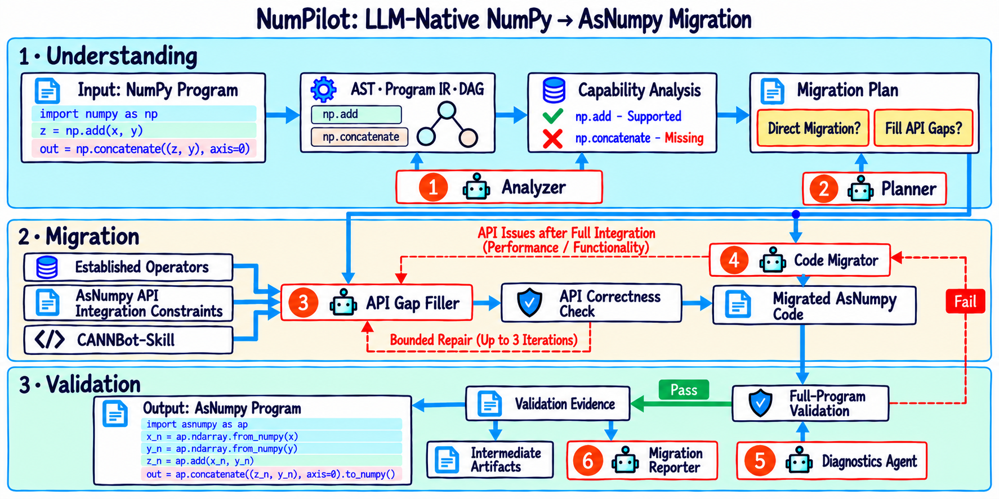

<div align="center">

<h1></h1>

### Auditable NumPy → AsNumpy migration for Ascend NPUs

<p>
  <a href="README.zh-CN.md">简体中文</a> ·
  <a href="docs/installation.md">Installation</a> ·
  <a href="docs/architecture.md">Implementation notes</a> ·
  <a href="CONTRIBUTING.md">Contributing</a> ·
  <a href="LICENSE">License</a>
</p>

<p>
  
  
  
  
  
  
</p>

</div>

> **Project status: active refactor.**
> NumPilot is being re-architected around the three-stage, six-role pipeline shown in the canonical PNG
> architecture diagrams below. The old architecture SVGs and their generator have been removed. The
> repository still contains legacy execution paths while the primary CLI is being connected to the new
> pipeline. CLI entry points, module layout, and internal interfaces may change until the refactor
> completes. For reproducible use, pin a commit or release.

## Overview

NumPilot is a migration framework for statically analyzable NumPy programs targeting AsNumpy on Ascend
NPUs. It separates model-generated candidates from deterministic admission: parsing, capability
resolution, builds, correctness checks, full-program validation, and receipts are deterministic; models
are used for understanding, planning, code migration, gap filling, diagnosis, and reporting.

Unsupported or ambiguous programs stop with a stable failure code instead of being silently rewritten or
routed to CPU.

## Target architecture

<p align="center">
  <a href="docs/assets/architecture/numpilot-architecture-en.png">
    
  </a>
</p>

<p align="center"><sub>English architecture diagram · <a href="docs/assets/architecture/numpilot-architecture-zh.png">中文架构图</a></sub></p>

The target pipeline has three stages and six model roles:

| Stage | Deterministic backbone | Model roles | Stage exit |
| --- | --- | --- | --- |
| Understand | AST, Program IR, DAG, capability analysis | ① Analyzer · ② Planner | Validated migration plan |
| Migrate | API registry, contracts, builds, API correctness check | ③ API Gap Filler · ④ Code Migrator | Migrated AsNumpy code |
| Validate | Full-program validation, receipts, manifest | ⑤ Diagnostics Agent · ⑥ Migration Reporter | Program + evidence + report |

The diagram describes the target design, not a module dependency graph of the current tree.

Two gates are never delegated to a model:

- **API correctness check** — per gap: build, load, dtype/shape/edge behavior, and numerical comparison
  with the NumPy oracle.
- **Full-program validation** — the migrated program against the source program, with named outputs,
  dtype/shape/numeric comparison, and a write-once receipt.

A generated operator remains `generated_unverified` until the API correctness check passes. A single
qualified operator does not imply a qualified program; the whole program must still clear full-program
validation.

## Refactor status

The refactor is organized around the following workstreams. Status labels describe the repository, not the
target design.

| Workstream | Status | Notes |
| --- | --- | --- |
| Architecture contract | Defined | This README and the architecture diagram define the target |
| Unified fact layer | In progress | Consolidating duplicated AST and call-site scanning |
| Capability registry | In progress | Merging coverage, catalog, and profile logic into one registry |
| ModelGateway | In progress | The private configured model is available; all role calls are being routed through one gateway |
| Analyzer / Planner | Scaffolded | Role records and deterministic planning exist; unified model calls remain to be wired |
| Code Migrator | In progress | Existing script migration path is being reduced to a single rewrite role |
| API Gap Filler | Scaffolded | Gap classification exists; candidate generation and API-gate integration remain |
| Full-program validation | Implemented | Retained as the deterministic program-level gate |
| Competition direct vertical slice | Planned | Direct source → model candidate → validation receipt → replay |
| Benchmark adapter | Planned | Added after the direct and gap vertical slices are stable |
| Diagnostics / Reporter | Scaffolded | Role records exist; validation-driven diagnosis and reporting remain to be unified |
| Legacy pipelines | To be retired | Moved to `compat/legacy` after parity is established |

## Development order

The development order follows the canonical PNG architecture and keeps one reviewable vertical slice in front of broad coverage:

1. Freeze role, artifact, receipt, and CLI contracts; finish the shared `ModelGateway`.
2. Complete a straight-line direct migration with `migrate --mode full`, deterministic validation, `verify`, and `replay`.
3. Complete one real gap, `np.concatenate`, through official-first resolution, API correctness, integration, and full-program validation.
4. Demonstrate rejection and repair of an intentionally bad candidate.
5. Qualify the current AsNumpy runtime before publishing strict-NPU or performance claims.
6. Adapt the 150-case benchmark, bundle CANNBot skills, and finish release/performance evidence.

The private `llm.json` is used only through the shared `ModelGateway`. Tokens, endpoints, and raw model responses must never enter run artifacts, logs, commits, or reports.

### What is changing

| Area | Current repository | Target |
| --- | --- | --- |
| Entry points | CLI, wizard, Agent Skill, legacy contract path | CLI dispatch plus one workflow coordinator |
| Model access | Per-module model providers | One ModelGateway |
| Capability logic | Multiple scanners and catalogs | One ApiRegistry |
| Migration paths | Parallel ordinary, contract, and gap chains | One Understand → Migrate → Validate pipeline |
| Receipts | Stage-specific variants | Unified receipt schema and run manifest |

## Requirements

NumPilot follows **your AsNumpy installation**, not a hard-coded environment matrix. If NumPy and AsNumpy
work in your interpreter, you have the environment NumPilot targets.

- **Python / NumPy**: the versions your AsNumpy build supports. NumPilot does not introduce its own upper
  pins.
- **AsNumpy**: installed and importable in the same interpreter that runs NumPilot.
- **CANN / Ascend driver / SoC**: discovered at runtime; NumPilot does not install or pin them.
- **NPU**: optional. Without one, analysis and shim verification still work; strict-NPU and performance
  claims require a real device and a qualified profile.

`numpilot doctor` reports the detected environment. An unknown combination is marked
`qualification_required`; it is not rejected and it is not silently treated as verified.

## Installation

Install NumPilot into the environment where AsNumpy already works:

```bash
git clone --branch main --depth 1 https://gitcode.com/li-xingHIT/numpilot.git
cd numpilot
python3 -m venv .venv
. .venv/bin/activate
python -m pip install .            # core CLI: plain-text fallback, no rich required
# python -m pip install '.[ui]'    # optional: colored TUI and interactive wizard

# NumPy and AsNumpy must already work in this interpreter
python -c "import numpy, asnumpy; print(numpy.__version__, asnumpy.__version__)"

python -m numpilot doctor --backend shim   # no NPU required
python -m numpilot doctor --backend npu    # on an Ascend machine
```

If AsNumpy lives in another virtual environment, activate that environment and install NumPilot there.
NumPilot uses the AsNumpy importable from its own interpreter. Frozen releases also carry the author-owned
hash-bound AsNumpy component and CANNBot skill snapshot under `components/`; the automatic runtime path
reads those snapshots and does not fetch or upgrade them.

For air-gapped, hash-bound, or reproducible deployments, see
[Installation and verification](docs/installation.md) and the
[AsNumpy API and CANNBot snapshot catalog](docs/asnumpy-api-support.zh-CN.md).

## Usage

> The CLI is still being consolidated. The commands below distinguish the development target from the
> currently supported legacy paths. Pin a commit for reproducible workflows.

### Target CLI contract

The competition route is converging on this contract:

```bash
numpilot analyze SOURCE [--json]
numpilot migrate SOURCE --mode full [--out RUN_DIR] [--json]
numpilot verify RUN_DIR [--json]
numpilot replay RUN_DIR [--json]
numpilot demo --case direct_add|gap_concatenate|bad_candidate
```

`analyze` is the no-model lane. `assisted` and `gap` are controlled fallback or ablation lanes. Until the refactor is complete, some target commands remain under implementation and the existing `verify-script` and `--mode contract` paths are legacy adapters.

### Terminal workflow

NumPilot can use an OpenAI-compatible model configured explicitly for it. The configuration is private and
opt-in; during the refactor, `llm.json` is consumed only by the shared `ModelGateway` and never copied into
run artifacts. The repository ships a blank `llm.example.json`; copy it to the git-ignored `llm.json` and fill in
your own values.

```bash
install -m 600 llm.example.json llm.json
# edit llm.json: base_url, auth_token, model
python -m numpilot paths --get llm_config
python -m numpilot configure-llm --check
python -m numpilot configure-llm --probe
numpilot
```

Inside the interactive shell:

```text
check llm
migrate /absolute/path/to/program.py
y
execute
exit
```

`y` authorizes candidate generation; `execute` separately authorizes running the displayed source and
candidate. Keep `llm.json` at mode `0600`; it is git-ignored, and `llm.example.json` must stay blank. Never
commit a filled configuration.

### Agent Skill workflow

If you use an IDE/sidebar AI that can read the workspace and run approved commands, NumPilot can operate
without `llm.json`. The sidebar model authors the candidate; NumPilot performs the deterministic gates.

```text
Read /absolute/path/to/numpilot/skill/SKILL.md and use its agent/no-llm lane.
Migrate /absolute/path/to/source.py with the model already available in this sidebar.
Do not read llm.json, do not run configure-llm or check llm, and do not invoke NumPilot's
configured-model provider. First perform read-only analysis and show me the plan. After I confirm,
author the candidate and submit only supported artifacts to NumPilot's deterministic gates.
Report stopped, unverified, numeric, runtime, and performance states without upgrading them.
```

A candidate without a registered adapter stops as `agent_authored_draft`; it cannot inherit strict-NPU or
performance claims.

## Design principles

- **Deterministic facts first.** Parsing, call-site extraction, capability resolution, builds, validation,
  and receipts are deterministic. Models do not add, remove, or silently reinterpret call sites.
- **Models generate; validators decide.** Every model output is a candidate. `ValidationReceipt` is
  written only by the validator.
- **AsNumpy is the compatibility source of truth.** Capability evidence is bound to the actual AsNumpy,
  Python ABI, CANN, and SoC in use. `hasattr` is not evidence.
- **No silent fallback.** Unsupported, ambiguous, or unqualified behavior stops with a stable failure
  code; CPU/host fallback requires explicit consent and disables strict-NPU/performance claims.
- **Write once, replay always.** Each run writes a new directory with hashes, model calls, receipts, and
  artifacts. Replay does not regenerate or recompile.

## Claims and evidence

- A migrated program is not verified merely because it was generated or compiled.
- A single qualified operator does not imply a qualified program.
- A benchmark of an isolated operator is not a whole-program speedup.
- An unqualified SoC/CANN/Python combination is not a strict-NPU result.

A claim without a receipt in the current run is reported as `qualification_required`,
`performance_valid=false`, or `blocked`.

## Repository layout

```text
numpilot/            CLI and core modules (being reorganized)
docs/                architecture, contracts, verification, installation
skill/               Agent Skill contract and references
components/asnumpy/  author-maintained, hash-bound AsNumpy wheel and provenance
components/cannbot-skills/  author-maintained static CANNBot skill bundle
tests/               regression tests and fixtures
tools/               repository and release utilities
```

## Documentation

- [Installation and verification](docs/installation.md)
- [Current implementation notes and trust boundaries](docs/architecture.md) — describes the current code
  while the canonical target remains the PNG architecture diagrams
- [Model configuration and transport contract](docs/model-contract.md)
- [Numerical verification](docs/script-verification.md)
- [Strict-NPU benchmarking](docs/script-benchmark.md)
- [Agent Skill contract](skill/SKILL.md)
- [Changelog](CHANGELOG.md)

## Security notes

- Migrate and execute only source code you trust. `python -I` isolation is not an operating-system
  sandbox.
- A configured remote model may receive source code and may incur usage charges.
- Generated kernels and integrations remain unverified until all required gates pass.
- Runtime identity or artifact drift produces an explicit blocked/audit-required result.

Report vulnerabilities through [SECURITY.md](SECURITY.md).

## Contributing

Contributions are welcome. Read [CONTRIBUTING.md](CONTRIBUTING.md), add tests for behavioral changes, and
run the relevant test and release-tree checks before opening a pull request. During the refactor, prefer
small, reviewable changes and keep legacy behavior behind `compat/legacy` rather than extending it.

## License

NumPilot is licensed under the [Apache License 2.0](LICENSE). Third-party components retain their own
licenses; see [THIRD_PARTY_NOTICES.md](THIRD_PARTY_NOTICES.md). Product names and logos remain the property
of their respective owners and do not imply endorsement.
