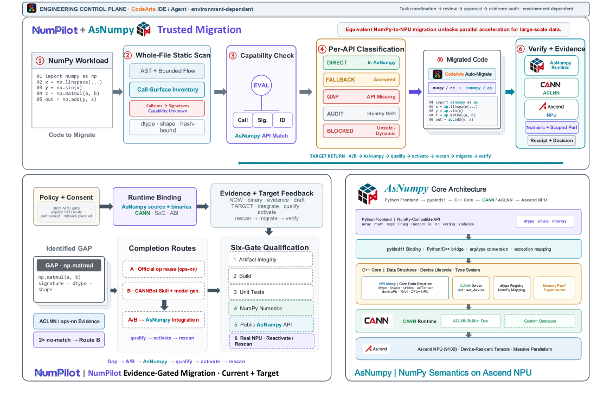
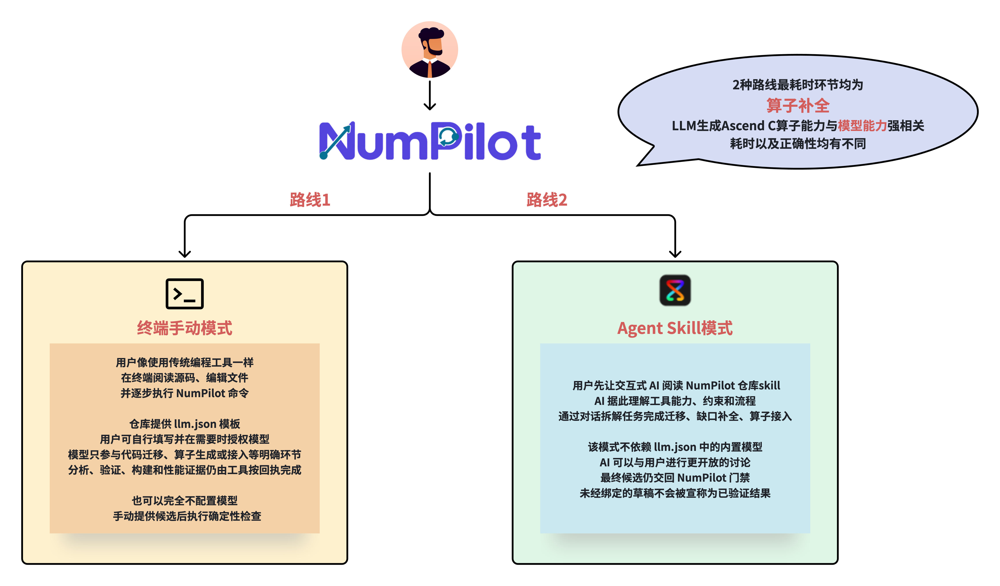

<div align="center">

<h1></h1>

### From NumPy programs to verified execution on Huawei Ascend NPU

<p>
  <a href="README.zh-CN.md">简体中文</a> ·
  <a href="docs/installation.md">Installation</a> ·
  <a href="docs/architecture.md">Architecture</a> ·
  <a href="docs/COMPETITION-READINESS.md">Competition readiness</a> ·
  <a href="docs/TERMINAL-COMPLETE-MIGRATION-DEMO.zh-CN.md">Terminal demo</a> ·
  <a href="evidence/README.md">Evidence</a> ·
  <a href="CONTRIBUTING.md">Contributing</a>
</p>

<p>
  
  
  
  
  
</p>

<p>
  <a href="docs/installation.md"></a>
  <a href="docs/numpilot-en-v6.svg"></a>
</p>

</div>

> [!IMPORTANT]
> NumPilot is an Alpha development snapshot, not a published release candidate. A successful installer or
> `doctor` run proves basic NPU availability only. Strict-NPU and performance claims are valid solely for the
> exact runtime profile and hash-bound receipts that produced them.

**NumPilot automatically migrates the supported, statically analyzable NumPy subset to functionally equivalent
NPU-backed implementations.** Unsupported or ambiguous Python behavior is reported and failed closed; it is never
silently rewritten as if it were supported. Within that boundary, NumPilot preserves program semantics and
numerical results while taking advantage of the NPU's massively parallel compute capacity.

The current Alpha snapshot supports a statically analyzable subset of ordinary, single-file NumPy programs.
Inputs use a top-level `import numpy as np` and must pass a fail-closed, whole-program capability gate before
migration. The installed AsNumpy/CANN/SoC runtime, model response, migrated AST, numerical result, and optional
performance claim are all checked against explicit evidence.

> **The model proposes a candidate. Deterministic evidence decides whether it may be adopted.**

<table align="center">
  <tr>
    <td align="center"><br><sub>AsNumpy</sub></td>
    <td align="center"><br><sub>CANN / ACLNN</sub></td>
    <td align="center"><br><sub>Ascend NPU</sub></td>
    <td align="center"><br><sub>Optional CodeArts collaboration</sub></td>
  </tr>
</table>

## Architecture: from NumPy input to verified NPU execution

<p align="center">
  <a href="docs/numpilot-en-v6.svg">
    
  </a>
</p>

<p align="center">
  <sub>
    Open the <a href="docs/numpilot-en-v6.svg">full-size English diagram</a> ·
    <a href="docs/numpilot-zh-v6.svg">中文架构图</a> ·
    <a href="docs/numpilot-en.pptx">English PPT</a> ·
    <a href="docs/ASNUMPY-INTERNAL-COMPONENT-LOCK.zh-CN.md">AsNumpy component lock</a> ·
    <a href="docs/assets/architecture/numpilot-architecture-en.svg">machine-auditable boundary map</a>
  </sub>
</p>

The v6 diagram distinguishes current primitives with solid paths from target automation with dashed paths. The
text summary below preserves the same meaning when SVG rendering or path-based text is inaccessible.

### How to read the architecture

| Stage | What NumPilot does | Gate or output |
|---|---|---|
| 1. Unclassified workload | Parses the complete program, extracts NumPy callsites, signatures, and bounded data flow | No API is labelled supported or missing at intake |
| 2. Capability check | Matches every callsite against the exact AsNumpy/CANN/SoC profile and records an independent decision | The strictest per-call result becomes the fail-closed workload result |
| 3. Whole-file migration | If every call is eligible, the configured-model lane can use the implemented hash-bound response/AST adapter; manual or CodeArts candidates continue only when a registered adapter accepts them | An adapter-accepted migration candidate, or an explicit `draft/stopped` result |
| 4. Gap completion | If an API is missing, NumPilot looks for reusable Huawei official operators first; by default only clean official misses may draft; an explicit `OperatorSpec` can opt into a draft-only route with `--allow-custom-operator-generation` while recording that official equivalence is unproven | Both routes converge on the same AsNumpy API integration boundary |
| 5. Qualification and feedback | Integration candidates pass artifact, build, unit, numerical, public-API, and real-NPU gates, then the original workload is rescanned | Only a fully eligible rescan may return to migration and verification |

For independent multi-gap experiments, `complete-gaps --continue-on-error` can continue after
one bounded model/validation failure. It still returns non-zero and records only redacted failure
metadata in `gap-report.json`; the default remains fail-fast, and no failed gap is activated.

<details>
<summary><strong>Text-only architecture flow and current route boundaries</strong></summary>

The ordinary, already-supported route is:

```text
unclassified NumPy source
  → whole-file AST + bounded data-flow analysis
  → per-call, runtime-bound capability decisions
  → fail-closed whole-workload result
  → configured-model candidate → hash-bound response + exact AST gate
    or manual/CodeArts candidate → registered adapter gate (otherwise draft/stopped)
  → adapter-accepted migration candidate
  → independent numerical verification
  → optional profile-bound strict-NPU benchmark
  → write-once evidence receipts
```

The API-gap route shown in the lower half of the diagram is:

```text
classified API gap
  → A. reuse an installed ACLNN candidate or audit a pinned ops-nn source candidate
  → B. after two clean misses, use pinned CANNBot Skills + an authorized boundary model
       (CodeArts agent or configured model) to draft a custom operator
  → integrate through the AsNumpy public API boundary
  → qualify → activate capability → rescan the original workload
  → migrate only after every callsite is eligible
```

Route outputs remain deliberately distinct. An installed official-binary discovery can reach
`CANDIDATE_READY`; only the reviewed installed-ACLNN MatMul slice currently reaches `ADAPTER_CANDIDATE`; pinned
`ops-nn` currently provides `SOURCE_EVIDENCE_ONLY`; and the CANNBot/model route produces an
`UNVERIFIED_OPERATOR_DRAFT`. Generic integration, qualification, activation, rescan, mixed-route orchestration,
and rollback are still target paths rather than an end-to-end implemented loop.

</details>

> **Core invariant:** the input workload is never pre-classified, a gap is never silently bypassed, and a newly
> completed API must be integrated into AsNumpy and survive a rescan before migration can continue.

## What is implemented

| Area | Current state | Boundary |
|---|---|---|
| Ordinary NumPy analysis | Implemented | Static whole-file analysis; it does not execute source or call a model |
| Five-state capability decision | Implemented | Bound to the installed AsNumpy/CANN/SoC identity and audit evidence |
| Configured-model rewrite | Implemented | OpenAI Chat Completions-compatible endpoint; exact model/response/AST/hash checks fail closed |
| Manual/CodeArts candidate handoff | Draft-only by default | Continues only through a registered hash-bound adapter; otherwise remains `draft/stopped` with verification and benchmark `not_run` |
| Numerical verification | Implemented | Original and migrated programs run in separate `python -I` workers; this is not an OS sandbox |
| Strict-NPU resident benchmark | Implemented, scoped | Requires an exact qualified profile; it is not a universal or cold-E2E claim |
| Official operator discovery | Implemented | Checks installed ACLNN, then pinned local `ops-nn` read-only source evidence; discovery does not build or integrate |
| Custom-operator drafting | Partial | CANNBot constrains a real boundary model, but generated Ascend C remains unverified until independently built and qualified |
| Gap completion | Registered exception | Exact scalar-one calls can use a real-NPU-qualified, run-scoped AsNumpy composition while the CANNBot draft remains unactivated; every generic gap still fails closed |
| CodeArts collaboration | Optional integration | Repository roles/skills exist; the actual control plane must be verified in the target account |

## Two primary ways to use NumPilot: terminal or AI/CodeArts

NumPilot separates candidate authoring from deterministic evidence. Choose one entry mode for each
run; switching modes requires a fresh private run directory and renewed authorization:

<p align="center">
  <a href="docs/assets/architecture/numpilot-two-routes.zh-CN.png">
    
  </a>
</p>

<p align="center"><sub>Conceptual illustration only—not performance or correctness evidence. Both routes share NumPilot's deterministic gates but differ in how candidates are authored.</sub></p>

1. **Terminal/configured lane (traditional tool use):** fill the private `llm.json`, start
   `numpilot`, and use its persistent shell like an ordinary development tool. `check llm` performs a
   small real connectivity request; `migrate` asks for an absolute source path, explains the program,
   waits for `y`, and asks separately for exact `execute` consent immediately before source execution.
   It then owns gap routing, migration, numeric checks, performance evidence, and the final report.
   Low-level manual commands remain available without a model.
2. **CodeArts-agent lane (natural interaction):** ask the CodeArts sidebar to read the repository and
   the root [`skill/SKILL.md`](skill/SKILL.md) (mirrored at
   `.codeartsdoer/skills/numpilot-migration-gate/SKILL.md`), then let its interactive model decompose
   and independently complete migration, gap completion, or operator drafting. This lane does not
   read `llm.json` or call NumPilot's built-in model. Label the isolated candidate
   `agent_authored_draft`, then hand it to NumPilot for hash/structure checks. Numerical and
   real-device gates run only when a registered adapter materializes the supported hash-bound
   migration report; otherwise stop at `draft` with later stages `not_run`.
   If your team wants a split workflow, these two methods can be combined as a **hybrid**: CodeArts
   owns conversation, planning, and drafting/review, while the terminal/CLI owns repeatable `analyze`
   and hash gates, plus `verify-script`/`benchmark-script` only for an adapter-accepted report. Preserve
   the CodeArts task/event reference and candidate label. If the combined run needs a configured model,
   switch and authorize explicitly in a new run directory; never mix receipts from the two sources.

The CodeArts-agent hard gate applies whenever the user says to use the sidebar model or “do not use
`llm.json`/the built-in model”: do not run `configure-llm`, pass `--provider llm`, probe an endpoint, or
silently fall back after a failure. Until an adapter binds complete model/response/source/artifact
evidence, manual or agent drafts cannot claim configured-model provenance, strict-NPU execution, or
performance. See the [CodeArts integration guide](docs/codearts-integration.md) and the
[NumPilot Skill](skill/SKILL.md) (the CodeArts mirror is
`.codeartsdoer/skills/numpilot-migration-gate/SKILL.md`).
The current `verify-script`/`benchmark-script` commands still require a supported hash-bound migration
report; if no adapter can materialize one for a manual or CodeArts candidate, stop at `draft` and report
that boundary rather than hand-editing a report.
The initial receipt created by Skill loading or a handoff must remain
`candidate_status=not_generated` with `agent_authored_draft=false`; only after the interactive model
actually writes a candidate should a separate hash-bound `codearts_agent_receipt` use the draft label.

Proxy settings are an optional environment detail, not a NumPilot requirement. If the site needs one,
set `HTTP_PROXY`/`HTTPS_PROXY` (and lowercase equivalents) in the current session; the repository and
receipts never hard-code proxy addresses, credentials, or private endpoints.

### Interactive terminal

The primary recording path is now the persistent product shell, not a one-click demo script. After
activating the installed runtime and privately configuring `llm.json`, start it with one command:

```bash
numpilot
```

Then type `check llm`, followed by `migrate`. The first command sends a small real request and reports
whether the configured model returned usable content. The second asks for an **absolute Python source
path**, prints the deterministic API/callsite and AsNumpy-gap analysis, displays the model's bounded
`interpreted_unverified` explanation, and waits for `y`. Only `y` starts generation and NPU
qualification. Immediately before the framework executes the original and normalized user scripts, it
requires a separate exact `execute` confirmation. The final screen links every artifact, the migrated
source, and both `migration-report.json` and `migration-report.md`.

For the smallest real gap demonstration, enter the absolute path to
`examples/add_one_migration_demo.py`. NumPilot recognizes only its exact
`numpy.add(array, 1)` signature and explains the missing run contract `asnumpy.add_one(x)`. It performs
official-first resolution, displays the full pinned CANNBot Skill used by the real configured-model
request, and shows a heartbeat while the model generates a bounded Ascend C `Adds` fragment. That
fragment remains `generated_unverified`: it is not compiled or activated. Separately, NumPilot builds a
run-scoped `asnumpy.add_one` composition from qualified `asnumpy.ones_like` plus `asnumpy.add`, admits it
only after isolated real-NPU qualification, lowers the program, and continues through migration, numeric
verification, performance, and the session report. Upstream AsNumpy and the shared OPP are unchanged.

Every other missing API still fails closed unless its own registered integration and qualification path
publishes an available interface. A plausible CANNBot draft is not enough to continue. Performance is
shown only when `performance_valid=true`, for the exact measured size and resident timing boundary; one
measurement does not establish a general crossover threshold.

An automated caller can use the same framework boundary with explicit consent:

```bash
python -m numpilot --llm-config /absolute/private/llm.json \
  interactive-migrate --source /absolute/path/to/source.py --yes --execute-source \
  --cannbot-gap-draft --accept-cannbot-license --show-cannbot-skill full
```

`--yes` confirms the automated migration flow; only `--execute-source` separately authorizes execution
of the displayed, hash-bound user scripts.

Proxy variables, when needed, are supplied by the current site before launch. NumPilot and its Skill do
not contain a fixed proxy address; `check llm` only requires that the selected model return a valid reply.

For AI/CodeArts mode, give the interactive model this option-gate instruction instead of launching the
configured lane: “Read the NumPilot Skill, use agent mode, and do not use the model from `llm.json`.” The
AI must then perform interpretation, completion, operator/integration authoring, and migration generation
itself, without reading or probing `llm.json`; deterministic NumPilot gates remain authoritative. If no
registered adapter accepts the agent artifact, stop at `migrate=draft/stopped` with verification and
benchmark `not_run`.

## Quick start

### CPU/shim development

This path lets contributors inspect the CLI and run a shim smoke check without CANN or an NPU:

```bash
git clone --branch main --depth 1 https://gitcode.com/li-xingHIT/numpilot.git
cd numpilot
python3 -m venv .venv
. .venv/bin/activate
python -m pip install -e '.[dev]'
python -m numpilot              # TTY product home
python -m numpilot --help
python -m numpilot doctor --backend shim
```

Interactive terminals get a compact landing page, progress indicators, and responsive `doctor`/`paths` views
(tables on wide terminals and vertical lists on narrow terminals).
Redirected output and all JSON/scalar modes remain stable plain text; set `NO_COLOR=1` to force plain output.

The complete suite is a release-matrix gate, not a portable quick-start check. It must run in the pinned test
environment with inherited CANN `PYTHONPATH` and proxy variables isolated; see [Contributing](CONTRIBUTING.md).

### NPU installation and the frozen AsNumpy component

For an internal or competition release, use the **frozen AsNumpy component mode** described in the
[AsNumpy internal-component lock](docs/ASNUMPY-INTERNAL-COMPONENT-LOCK.zh-CN.md). This checkout carries the
locked Linux/AArch64 CPython 3.10 wheel under `components/asnumpy/`, together with its SHA-256, upstream
LICENSE and SPDX SBOM. The installer verifies that local bundle with `--no-index` semantics; it never resolves
`latest`, a version range, or a moving Git ref, and it does not fetch AsNumpy source when the bundle is present.
A hash mismatch or missing component is a release-blocking `CAPABILITY_AUDIT_REQUIRED`/`BLOCKED` result, not a
reason to silently substitute another build.

Before freezing a release commit, verify the source candidate and the bundled component together:

```bash
python tools/check_release_tree.py --require-asnumpy-component --json
```

The normal audit (without `--require-asnumpy-component`) remains useful for day-to-day development and reports a
missing platform wheel as a warning; it never turns a missing attachment into a successful installation.

The maintainer source-first flow is only a **development/build-preparation path** for producing and auditing a
future component, not the user-facing contract for a frozen release; the complete command is in the
[source-build section of the installation guide](docs/installation.md). A component-mode target still needs the
matching CANN/driver/OPP runtime, and the local wheel is installed once into its venv; no AsNumpy source
checkout is needed on site.

For the frozen component path, the target machine only needs a compatible Ascend driver/firmware, CANN and
OPP, a visible NPU, Python 3.10+ with `venv`/`pip`, and a user-owned runtime directory. Installing the fixed
wheel does not require Git, CMake, a compiler, Python development headers, or the system `fmt`/`spdlog`
development packages; the installer never runs `sudo` or edits shell startup files. The full Git, GCC 11.2+,
Python-header, CMake/Make/Ninja, and `fmt`/`spdlog` toolchain is required only when a maintainer explicitly
uses `--asnumpy-source` to build the next component.

```bash
./install.sh --allow-network \
  --asnumpy-component "$PWD/components/asnumpy" \
  --cann-env /usr/local/Ascend/cann-9.0.0/set_env.sh \
  --venv /absolute/user-owned/numpilot-venv \
  --persistent-root /absolute/user-owned/numpilot-runtime

. /absolute/user-owned/numpilot-runtime/activate-numpilot.sh
python -m numpilot bootstrap --verify --json
python -m numpilot doctor --backend npu
```

The direct parent of `--venv` must already exist, be owned by the current user, and not be group/world writable.
Use paths owned exclusively by your account. With `--asnumpy-component`, the installer reads only the local,
hash-bound wheel and does not fetch AsNumpy source; this installer still requires explicit `--allow-network`,
but network access is only for possible initial NumPilot dependency installation. The `--asnumpy-source` option is a maintainer-only explicit
source-build path. The complete dependency matrix, CANNBot option, post-install receipts, strict-profile check,
troubleshooting, and safe cleanup are in the
**[installation guide](docs/installation.md)**.

Do not use `pip install numpilot` for this snapshot: there is no verified public package release for the current
source tree.

## Configure the model (optional terminal configured sub-run)

These commands apply to the terminal/manual lane or to a hybrid run that explicitly switches to a
configured model. They are not part of the CodeArts-agent lane; when the user says not to use
`llm.json`, do not read this file, run `configure-llm`, or probe an endpoint. A terminal/manual run may
also omit model configuration and provide a candidate for deterministic gates.

```bash
python -m numpilot configure-llm --init
# Edit the private llm.json path printed by the command.
python -m numpilot configure-llm --check   # local config + proxy gate; no network
python -m numpilot configure-llm --probe   # one real request; may incur cost
```

When a competition runtime keeps the private file outside the repository, use
`NUMPILOT_RUNTIME_ROOT=/absolute/persistent/numpilot-runtime` for the whole
session, or select one file for a single command with
`python -m numpilot --llm-config /absolute/persistent/numpilot-runtime/.numpilot-config/llm.json configure-llm --check`.
The option is also accepted after a subcommand; neither form prints the token.

The configuration directory must be private (`0700`) and `llm.json` must be `0600`. Tokens, private endpoints,
proxy URLs, and raw model response bodies must never be committed. See the
[model contract](docs/model-contract.md) for proxy fail-closed behavior and receipt rules.

> [!WARNING]
> Every configured-model generation or repair request may incur cost. `migrate` sends the complete input source;
> gap/operator paths send the bounded gap contract, statically extracted semantic function, applicable draft or
> diagnostics, and selected CANNBot Skill context; AsNumpy adapter paths send target-projected source/header
> context, Skill context, overlays, and applicable diagnostics. CANNBot supplies pinned workflow context; the
> explicitly selected boundary model (CodeArts agent or configured remote model) generates the draft.
> `verify-script`, `benchmark-script`, and `run_demo.sh` execute the
> original program and candidate with the current user's permissions. `python -I` is **not** an OS sandbox. Send
> only material you may disclose, run only trusted programs, and isolate untrusted input in a container or VM.

## Competition preflight

`competition-readiness` is a read-only audit of the judging dimensions, required attachments, and evidence
gaps. It does not execute source, access the network, or turn repository CodeArts Agent/Skill files into a
claim that the CodeArts control plane actually ran. With a private runtime configuration kept outside the
repository:

```bash
RUNTIME_ROOT=/absolute/persistent/numpilot-runtime
source "$RUNTIME_ROOT/activate-numpilot.sh"
python -m numpilot --llm-config "$RUNTIME_ROOT/.numpilot-config/llm.json" \
  competition-readiness --json
```

For a low-level non-interactive ordinary path, use `run`; the recommended human recording remains the
persistent `numpilot` shell. `--benchmark` only publishes a strict device-resident performance result,
not cold-start or end-to-end latency:

```bash
python -m numpilot --llm-config "$RUNTIME_ROOT/.numpilot-config/llm.json" \
  run examples/poisson_source_smooth_l1_map.py --backend npu --benchmark
# or: ./run_demo.sh --llm-config "$RUNTIME_ROOT/.numpilot-config/llm.json" --quick
```

If `--out` is supplied to `run`, point it at a new, non-existent directory; write-once receipts intentionally
reject reusing an old run. Omit `--out` to let NumPilot create a unique directory under its external demo state.

Without Ascend, use `--backend shim --fallback-policy accept` only for a numerical diagnostic. It keeps
the model/AST/numerical receipts but can never publish a strict-NPU or performance claim and does not
replace the competition hardware demonstration.

`official_score` in the report is always `null`: the checker lists observed evidence and remediation only.
Actual CodeArts account execution, Huawei Cloud deployment, video access, and real business/data evidence
still require separate verifiable receipts. For a complete terminal migration recording, follow the
[terminal demo runbook](docs/TERMINAL-COMPLETE-MIGRATION-DEMO.zh-CN.md). See also
[competition readiness](docs/COMPETITION-READINESS.md).

## Run the ordinary flow

The input must be trusted and assign its final result to a named variable (here, `result`):

```bash
SOURCE=/absolute/path/to/trusted_script.py
RUN_DIR="$(mktemp -d "${TMPDIR:-/tmp}/numpilot-run.XXXXXX")"

python -m numpilot analyze "$SOURCE" --require-direct --out "$RUN_DIR/analysis.json"
python -m numpilot migrate "$SOURCE" \
  --mode script --engine llm --backend npu --fallback-policy reject \
  --out "$RUN_DIR/migration"
python -m numpilot verify-script "$SOURCE" \
  --migration-report "$RUN_DIR/migration/script-migration-report.json" \
  --output result --out "$RUN_DIR/verification.json"
```

`./run_demo.sh --quick` is the repository's staged demonstration wrapper and additionally runs a scoped benchmark.
By default, each run uses a new repository-external state directory; inspect configured locations with
`python -m numpilot paths --json`. Benchmark claims require the separate
[strict-NPU benchmark contract](docs/script-benchmark.md).

The analyzer records an independent decision for every callsite, then exposes a fail-closed aggregate result for
the complete workload using the same five-state vocabulary:

| State | Meaning |
|---|---|
| `DIRECT` | The exact runtime profile has qualified the requested surface |
| `FALLBACK_CONSENT` | An audited CPU/host route exists and requires explicit user consent |
| `GAP_REQUIRED` | The API is missing, or the user rejected an audited fallback |
| `CAPABILITY_AUDIT_REQUIRED` | A callable exists, but its runtime identity or provenance is not qualified |
| `BLOCKED` | Dynamic or unmodeled Python behavior cannot be migrated safely |

## Runtime support and evidence scope

The package metadata supports Python 3.10+, but that is not the strict-NPU compatibility matrix. The current
strict profile is bound to Linux/AArch64, Ascend 910B4, CANN 9.0.0, CPython 3.10.20, and the pinned AsNumpy
source/install/receipt hashes. Any other hardware, CANN, Python ABI, wrapper, native library, or receipt remains
basic-install or candidate evidence until independently audited; no unpublished working log is release evidence.
The frozen-component release additionally binds the exact AsNumpy wheel bytes and installed Python/native module
hashes; a Git commit alone is not a reproducible binary artifact. See the
[internal-component lock](docs/ASNUMPY-INTERNAL-COMPONENT-LOCK.zh-CN.md) for the reference identity and the
required rebuild/upgrade procedure.

Curated development evidence remains available for audit:

- [Poisson-Ritz staged evidence](evidence/competition-poisson-stage-20260828/README.md)
- [Elementwise advantage-range evidence](evidence/competition-ordinary-20260828/README.md)
- [Evidence index and offline audit commands](evidence/README.md)

These receipts are development evidence and must not be generalized to different hardware, CANN, Python,
AsNumpy, input shape, dtype, or timing scope.

## Branch and release model

Repository policy permits only two long-lived branches:

- `main`: the release branch; tags and release artifacts come only from a verified `main` commit.
- `develop`: the integration branch and normal contribution/validation target.

External work should use a fork and open a pull request into `develop`; release promotion is a reviewed
`develop → main` pull request. Both branches **must** be protected against force-push, history rewriting, and
unreviewed direct changes in GitCode. Local refs are aligned; server-side default-branch, head, and protection
settings still require an administrator check. See the
[branch governance and release policy](docs/SUBMISSION.md).

### Manual push handoff

NumPilot does not run `git add`, `git commit`, or `git push` for you. Before handing this tree to the maintainer,
review the complete candidate set and run:

```bash
git status --short --untracked-files=all
python tools/check_release_tree.py --require-asnumpy-component --json
git diff --check
```

Stage only the reviewed source, curated public evidence, and `components/asnumpy/` attachments; keep raw
CodeArts/Huawei Cloud/video records, virtual environments, runtime state, generated build output, and any local
archive outside Git. Push through the protected, reviewed workflow described in [the submission policy](docs/SUBMISSION.md),
not directly to `main`.

## Documentation

- [Installation and verification](docs/installation.md)
- [Current architecture and implementation boundaries](docs/architecture.md)
- [CodeArts entry modes and model-source gates](docs/codearts-integration.md)
- [NumPilot Skill (root entry)](skill/SKILL.md) · [CodeArts mirror](.codeartsdoer/skills/numpilot-migration-gate/SKILL.md)
- [Documentation index](docs/README.md)
- [Numerical verification contract](docs/script-verification.md)
- [Strict-NPU benchmark contract](docs/script-benchmark.md)
- [AsNumpy internal component lock and release contract](docs/ASNUMPY-INTERNAL-COMPONENT-LOCK.zh-CN.md)
- [AsNumpy custom operator completion flow (static PNG)](docs/numpilot-asnumpy-custom-operator-flow.png) · [fixed-coordinate draw.io source](docs/numpilot-asnumpy-custom-operator-flow.drawio)
- [Gap recovery state machine](docs/gap-recovery-state.md)
- [Changelog](CHANGELOG.md)
- [Issue tracker](https://gitcode.com/li-xingHIT/numpilot/issues)
- [Security policy](SECURITY.md)
- [Contribution guide](CONTRIBUTING.md)

## License and trademarks

NumPilot is licensed under [Apache License 2.0](LICENSE). Third-party components retain their own licenses; see
[THIRD_PARTY_NOTICES.md](THIRD_PARTY_NOTICES.md) and the
[brand asset inventory](docs/assets/brand/README.md). Product names and logos are used for technical
identification only, remain the property of their respective owners, and do not imply endorsement. Publication
of the screenshot-derived assets requires the repository owner to confirm the applicable trademark/use rights.
