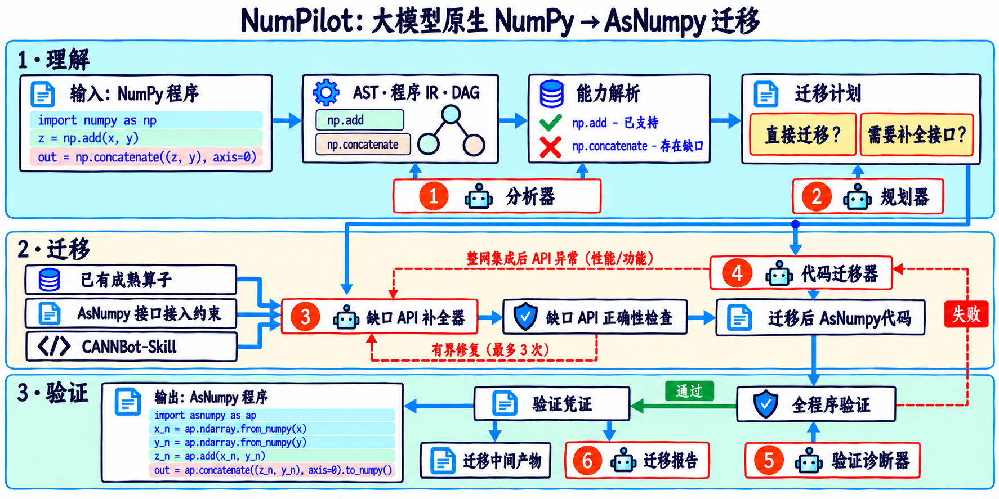

<div align="center">

<h1></h1>

### 面向 Ascend NPU 的可审计 NumPy → AsNumpy 迁移

<p>
  <a href="README.md">English</a> ·
  <a href="docs/installation.zh-CN.md">安装指南</a> ·
  <a href="docs/architecture.md">实现说明</a> ·
  <a href="CONTRIBUTING.md">参与贡献</a> ·
  <a href="LICENSE">许可证</a>
</p>

<p>
  
  
  
  
  
  
</p>

</div>

> **项目状态：正在重构。**
> NumPilot 正在按照下方两张 PNG 架构图收敛到三阶段、六角色主链。旧架构 SVG 和生成器已经删除；
> 仓库中仍保留部分旧执行路径，正在接入新的主 CLI。重构完成前，CLI 入口、模块布局和内部接口可能
> 发生变化。需要可复现使用时，请固定 commit 或 release。

## 概述

NumPilot 是面向 Ascend NPU 上 AsNumpy 的 NumPy 程序迁移框架，目标程序需可静态分析。框架将模型
生成的候选与确定性准入分离：解析、能力解析、构建、正确性检查、全程序验证和回执由确定性组件完成；
模型用于理解、规划、代码迁移、缺口填补、诊断和报告。

不支持或语义不明确的程序会以稳定的失败码停止，不会被静默改写或回退到 CPU。

## 目标架构

<p align="center">
  <a href="docs/assets/architecture/numpilot-architecture-zh.png">
    
  </a>
</p>

<p align="center"><sub>中文架构图 · <a href="docs/assets/architecture/numpilot-architecture-en.png">English diagram</a></sub></p>

目标流水线包含三个阶段和六个模型角色：

| 阶段 | 确定性主干 | 模型角色 | 阶段出口 |
| --- | --- | --- | --- |
| 理解（Understand） | AST、Program IR、DAG、能力分析 | ① Analyzer · ② Planner | 经过验证的迁移计划 |
| 迁移（Migrate） | API 注册表、契约、构建、API 正确性检查 | ③ API Gap Filler · ④ Code Migrator | 已迁移的 AsNumpy 代码 |
| 验证（Validate） | 全程序验证、回执、manifest | ⑤ Diagnostics Agent · ⑥ Migration Reporter | 程序 + 证据 + 报告 |

该图描述目标设计，不是当前代码树的模块依赖图。

两条 gate 不会交给模型：

- **API 正确性检查**——针对每个缺口：构建、加载、dtype/shape/边界行为，以及与 NumPy oracle 的数值对比。
- **全程序验证**——迁移后程序与源程序对比，包含命名输出、dtype/shape/数值比较和一次写入的回执。

生成的算子在 API 正确性检查通过前保持 `generated_unverified`。单个算子合格不代表程序合格；整个程序
仍必须通过全程序验证。

## 重构状态

重构按以下工作流组织。状态标签描述仓库现状，不描述目标设计。

| 工作流 | 状态 | 说明 |
| --- | --- | --- |
| 架构契约 | 已定义 | 本 README 与架构图定义目标 |
| 统一事实层 | 进行中 | 合并重复的 AST 与调用点扫描 |
| 能力注册表 | 进行中 | 将覆盖、目录与画像逻辑合并为单一注册表 |
| ModelGateway | 进行中 | 私有配置模型已经可用，正在统一接入一个共享网关 |
| Analyzer / Planner | 已搭骨架 | 角色记录和确定性规划已存在，统一模型调用仍待接入 |
| Code Migrator | 进行中 | 现有脚本迁移路径正在收敛为单一改写角色 |
| API Gap Filler | 已搭骨架 | 缺口分类已存在，候选生成和 API gate 接入仍待完成 |
| 全程序验证 | 已实现 | 保留为确定性的程序级 gate |
| 比赛直迁垂直切片 | 计划中 | 源程序 → 模型候选 → 验证回执 → replay |
| Benchmark adapter | 计划中 | 直迁和缺口垂直切片稳定后再接入 |
| Diagnostics / Reporter | 已搭骨架 | 角色记录已存在，基于验证结果的诊断和报告仍待统一 |
| 旧流水线 | 待退役 | 达到行为对等后移入 `compat/legacy` |

## 开发顺序

后续开发严格按照两张 PNG 架构图推进，先完成一条可审查的垂直闭环，再扩大覆盖面：

1. 冻结角色、工件、回执和 CLI 契约，完成共享 `ModelGateway`。
2. 用 `migrate --out RUN_DIR` 跑通 straight-line 直迁、确定性验证、`verify` 和 `replay`。
3. 以 `np.concatenate` 跑通 official-first、API 正确性检查、集成和全程序验证。
4. 展示错误候选被拒绝、诊断并在预算内修复。
5. 审计当前 AsNumpy 运行时，再发布 strict-NPU 或性能结论。
6. 最后接入 150 个 benchmark、静态 CANNBot bundle 和发布/性能证据。

私有 `llm.json` 只允许由共享 `ModelGateway` 使用；token、endpoint 和原始模型响应不能进入运行工件、日志、提交或报告。

### 变化内容

| 方面 | 当前仓库 | 目标 |
| --- | --- | --- |
| 入口 | CLI、向导、Agent Skill、旧契约路径 | CLI 分发加单一工作流协调器 |
| 模型访问 | 各模块自带模型提供方 | 单一 ModelGateway |
| 能力逻辑 | 多套扫描器与目录 | 单一 ApiRegistry |
| 迁移路径 | 普通、契约、缺口三条并行链路 | 单一 Understand → Migrate → Validate 流水线 |
| 回执 | 分阶段的不同结构 | 统一回执 schema 与运行 manifest |

## 环境要求

NumPilot 跟随**你实际安装的 AsNumpy**，不维护硬编码的环境矩阵。只要 NumPy 与 AsNumpy 在同一个
解释器中可用，就具备 NumPilot 所需的环境。

- **Python / NumPy**：以你的 AsNumpy 构建所支持的版本为准。NumPilot 不额外引入自己的版本上限。
- **AsNumpy**：已安装，并可在运行 NumPilot 的同一解释器中导入。
- **CANN / Ascend 驱动 / SoC**：运行时探测；NumPilot 不安装、也不固定这些组件。
- **NPU**：可选。没有 NPU 时，分析与 shim 验证仍可工作；strict-NPU 与性能结论需要真实设备和
  已评审的运行时画像。

`numpilot doctor` 会报告探测到的环境。未知组合会被标记为 `qualification_required`，既不会被拒绝，
也不会被静默视为已验证。

## 安装

在 AsNumpy 已经可用的环境中安装 NumPilot：

```bash
git clone --branch main --depth 1 https://gitcode.com/li-xingHIT/numpilot.git
cd numpilot
python3 -m venv .venv
. .venv/bin/activate
python -m pip install .            # 核心 CLI：纯文本回退，无需 rich
# python -m pip install '.[ui]'    # 可选：彩色 TUI 与交互式向导

# NumPy 与 AsNumpy 必须已能在该解释器中工作
python -c "import numpy, asnumpy; print(numpy.__version__, asnumpy.__version__)"

python -m numpilot doctor --backend shim   # 无需 NPU
python -m numpilot doctor --backend npu    # 在 Ascend 机器上
```

如果 AsNumpy 位于另一个虚拟环境，请先激活那个环境，再把 NumPilot 安装进去。NumPilot 使用其自身
解释器中可导入的 AsNumpy。冻结发布还会在 `components/` 中携带作者维护的哈希绑定 AsNumpy 组件和
CANNBot Skill 快照；自动运行路径只读取这些快照，不联网拉取或升级。

离线、哈希绑定或需要可复现的部署方式，见[安装与验收](docs/installation.zh-CN.md)和
[AsNumpy API 与 CANNBot 快照清单](docs/asnumpy-api-support.zh-CN.md)。

## 使用

> CLI 是正式执行契约。下面明确标出底层兼容入口，保证可复现工作流使用同一组阶段命令和回执。

### 唯一正式 CLI 契约

CLI 是 NumPilot 唯一的正式执行契约，负责工作流状态、哈希绑定工件、确定性门禁和 JSON 回执。
IDE/侧栏 Agent Skill 是可选适配器，只负责交互、审批、任务编排和结果展示，不维护第二套迁移或
验证引擎。

公开阶段命令为：

```bash
numpilot analyze SOURCE [--json]
numpilot migrate SOURCE --out RUN_DIR
numpilot verify SOURCE \
  --migration-report RUN_DIR/migration/script-migration-report.json \
  --output result --out RUN_DIR/verification.json [--json]
numpilot replay RUN_DIR [--json]
```

`run` 仍是同一套阶段的便捷协调器。`verify-script`、`benchmark-script`、
`interactive-migrate` 和 `--mode contract` 保留为底层或兼容接口；它们共享同一套回执和门禁，
不构成第二个产品。`replay` 是只读操作，只校验 workflow report 与阶段回执，不调用模型、不执行
用户源码，也不运行 NPU 阶段。

### 终端/配置模型 CLI 路线

终端路线是 CLI 正式契约上的配置模型适配器。NumPilot 可以使用为它显式配置的 OpenAI-compatible 模型。配置是私有且可选启用的；重构期间 `llm.json` 只由共享 `ModelGateway` 读取，不会复制到运行工件。仓库内提供空白模板
`llm.example.json`；复制为被 `.gitignore` 忽略的 `llm.json` 后填写自己的值。

```bash
install -m 600 llm.example.json llm.json
# 编辑 llm.json：base_url、auth_token、model
python -m numpilot paths --get llm_config
python -m numpilot configure-llm --check
python -m numpilot configure-llm --probe
numpilot
```

进入交互式 shell 后：

```text
check llm
migrate /absolute/path/to/program.py
y
execute
exit
```

`y` 授权生成候选；`execute` 另行授权运行已展示的源码与候选。请保持 `llm.json` 权限为 `0600`；
它已被 `.gitignore` 忽略，`llm.example.json` 必须保持空白。绝不能提交填写后的配置。

### Agent Skill 工作流（可选侧栏适配器）

如果你使用的 IDE/侧边栏 AI 能读取工作区并执行经授权的命令，NumPilot 可以在没有 `llm.json` 的情况下
工作。侧边栏模型负责生成候选，适配器调用同一套正式 CLI 并展示回执；它不复制迁移、验证、能力或
性能逻辑。

```text
请阅读 /absolute/path/to/numpilot/skill/SKILL.md，并使用其中的 agent/no-llm 路线。
请用当前侧边栏已经提供的模型迁移 /absolute/path/to/source.py。
不要读取 llm.json，不要运行 configure-llm 或 check llm，也不要调用 NumPilot 配置的模型。
先只读分析源码并向我展示计划；我确认后，由你生成候选，并只把框架支持的制品提交给
NumPilot 的确定性门禁。请如实报告 stopped、unverified、数值、运行时和性能状态，不得升级结论。
```

没有登记适配器的候选会停在 `agent_authored_draft`，不能继承 strict-NPU 或性能结论。

## 设计原则

- **确定性事实优先。** 解析、调用点提取、能力解析、构建、验证和回执都是确定性的。模型不会增加、
  删除或静默重新解释调用点。
- **模型生成，验证器裁决。** 所有模型输出都是候选。`ValidationReceipt` 只由验证器写入。
- **AsNumpy 是兼容性的唯一来源。** 能力证据绑定到实际使用的 AsNumpy、Python ABI、CANN 和 SoC。
  `hasattr` 不构成证据。
- **不静默回退。** 不支持、语义不明确或未通过资格验证的行为会以稳定的失败码停止；CPU/主机回退需要
  显式同意，并会关闭 strict-NPU/性能结论。
- **一次写入，始终可重放。** 每次运行写入新目录，包含哈希、模型调用、回执和制品。重放不会重新生成
  或重新编译。

## 结论与证据

- 迁移后的程序不会仅因为被生成或编译就视为已验证。
- 单个算子合格不代表整个程序合格。
- 单个算子的基准测试不等于全程序加速。
- 未通过资格验证的 SoC/CANN/Python 组合不构成 strict-NPU 结论。

如果某项结论在本次运行中没有对应回执，系统会报告为 `qualification_required`、
`performance_valid=false` 或 `blocked`。

## 仓库结构

```text
numpilot/            CLI 与核心模块（正在重组）
docs/                架构、契约、验证、安装
skill/               Agent Skill 契约与参考
components/asnumpy/  作者维护的 AsNumpy wheel、完整源码基线、来源材料与契约审计探针
components/cannbot-skills/  作者维护的静态 CANNBot Skill bundle
tests/               回归测试与 fixtures
tools/               仓库与发布工具
```

## 文档

- [安装与验收](docs/installation.zh-CN.md)
- [当前实现说明与信任边界](docs/architecture.md)——描述当前代码；目标设计以两张 PNG 架构图为准
- [模型配置与传输契约](docs/model-contract.md)
- [数值验证](docs/script-verification.md)
- [strict-NPU 性能测试](docs/script-benchmark.md)
- [Agent Skill 契约](skill/SKILL.md)
- [变更记录](CHANGELOG.md)

## 安全说明

- 只迁移和执行可信源码；`python -I` 隔离不是操作系统沙箱。
- 配置的远端模型可能接收源码，并可能产生调用费用。
- 生成的 kernel 与接入代码在全部必要 gate 通过前始终未验证。
- 运行时身份或制品发生漂移时，系统会明确阻断或要求重新审计。

安全问题请按 [SECURITY.md](SECURITY.md) 报告。

## 参与贡献

欢迎贡献。提交 Pull Request 前，请阅读 [CONTRIBUTING.md](CONTRIBUTING.md)，为行为变化补充测试，并运行
相关测试与发布树检查。重构期间请优先提交小而易审的变更；旧行为应保留在 `compat/legacy`，而不是继续
扩展。

## 许可证

NumPilot 使用 [Apache License 2.0](LICENSE)。第三方组件保留各自许可证，详见
[THIRD_PARTY_NOTICES.md](THIRD_PARTY_NOTICES.md)。产品名称和 Logo 权利归各自所有者，不表示赞助或背书。
