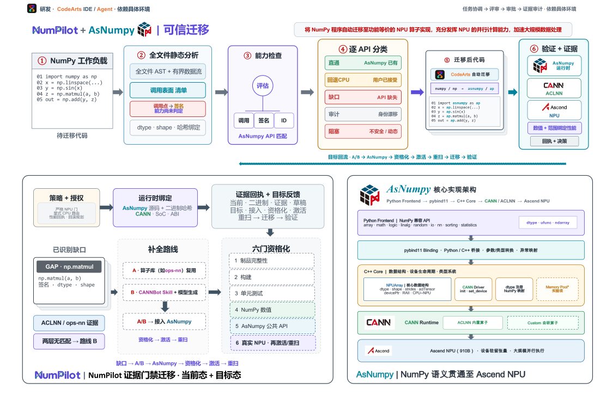
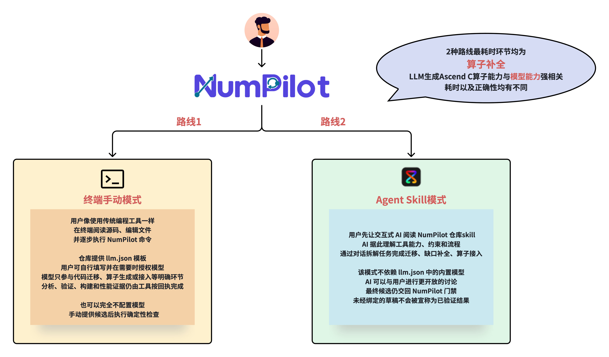

<div align="center">

<h1></h1>

### 从 NumPy 程序到经过验证的华为 Ascend NPU 执行

<p>
  <a href="README.md">English</a> ·
  <a href="docs/installation.zh-CN.md">安装指南</a> ·
  <a href="docs/architecture.md">系统架构</a> ·
  <a href="docs/COMPETITION-READINESS.md">比赛就绪度</a> ·
  <a href="docs/TERMINAL-COMPLETE-MIGRATION-DEMO.zh-CN.md">终端迁移录屏</a> ·
  <a href="evidence/README.md">证据审计</a> ·
  <a href="CONTRIBUTING.md">参与贡献</a>
</p>

<p>
  
  
  
  
  
</p>

<p>
  <a href="docs/installation.zh-CN.md"></a>
  <a href="docs/numpilot-zh-v6.svg"></a>
</p>

</div>

> [!IMPORTANT]
> NumPilot 当前是 Alpha 开发快照，不是已经发布的 RC。安装器或 `doctor` 通过只证明 NPU 基础可用；
> strict-NPU 与性能结论只对生成证据时绑定的精确运行时画像和哈希回执有效。

**NumPilot 会在受支持、可静态分析的 NumPy 子集中自动生成等价的 NPU 算子实现。**
对于不支持或语义不明确的 Python 行为，系统会明确报告并失败关闭，不会静默改写成“已支持”。
在这个边界内，NumPilot 保持程序语义和计算结果一致，并利用 NPU 的大规模并行能力加速数据处理。

当前 Alpha 快照支持可静态分析的普通单文件 NumPy 子集。输入需使用顶层 `import numpy as np`，
并在迁移前通过失败关闭的全程序能力门禁。系统会对已安装的 AsNumpy/CANN/SoC 运行时、模型响应、
迁移后 AST、数值结果及可选性能结论分别建立并核验证据。

> **模型负责提出候选；确定性证据决定候选能否采用。**

<table align="center">
  <tr>
    <td align="center"><br><sub>AsNumpy</sub></td>
    <td align="center"><br><sub>CANN / ACLNN</sub></td>
    <td align="center"><br><sub>Ascend NPU</sub></td>
    <td align="center"><br><sub>可选 CodeArts 协作</sub></td>
  </tr>
</table>

## 系统架构：从 NumPy 输入到经过验证的 NPU 执行

<p align="center">
  <a href="docs/numpilot-zh-v6.svg">
    
  </a>
</p>

<p align="center">
  <sub>
    打开<a href="docs/numpilot-zh-v6.svg">中文高清架构图</a> ·
    <a href="docs/numpilot-en-v6.svg">English diagram</a> ·
    <a href="docs/numpilot-zh.pptx">单页架构 PPT</a> ·
    <a href="docs/ASNUMPY-INTERNAL-COMPONENT-LOCK.zh-CN.md">AsNumpy 内部组件锁定合同</a> ·
    <a href="docs/assets/architecture/numpilot-architecture-zh.svg">可机器审计的边界图</a>
  </sub>
</p>

v6 架构图使用实线表示当前原语，使用虚线表示目标自动化路径。如果平台无法渲染 SVG 或读取轮廓化文字，
下方文本摘要保留了相同语义。

### 如何阅读这张架构图

| 阶段 | NumPilot 的处理 | 门禁或输出 |
|---|---|---|
| 1. 未分类工作负载 | 解析完整程序，提取 NumPy 调用点、签名和有界数据流 | 入口不预先标注 API 已支持或缺失 |
| 2. 能力检查 | 依据精确的 AsNumpy/CANN/SoC 画像逐调用点匹配，并独立记录判定 | 采用最严格的逐调用结果，生成失败关闭的整份工作负载结论 |
| 3. 全文件迁移 | 全部调用合格后，配置模型路线可使用已实现的哈希绑定响应/AST 适配器；手动或 CodeArts 候选只有被已登记适配器接受才继续 | 产生适配器接受的迁移候选，否则明确停在 `draft/stopped` |
| 4. 缺口补全 | API 缺失时优先查找可复用的华为官方算子；默认只有官方路径明确无匹配后才生成；显式 `OperatorSpec` 可用 `--allow-custom-operator-generation` 开启“官方等价未证明”的 draft-only 试验 | 两条路线统一汇入 AsNumpy 公共 API 接入边界 |
| 5. 资格化与回流 | 接入候选依次通过制品、构建、单测、数值、公共 API 和真实 NPU 门禁，然后重新扫描原工作负载 | 只有重扫后全部调用合格，才能返回迁移与验证主链 |

对于彼此独立的多缺口试验，可使用 `complete-gaps --continue-on-error`：单个模型或本地校验
失败后继续处理其余缺口，但命令仍返回非零，并只在 `gap-report.json` 写入脱敏失败元数据；
默认策略仍是 fail-fast，失败缺口不会被激活。

<details>
<summary><strong>文本版架构流程与当前路由边界</strong></summary>

图中上半部分表示 API 已经具备合格能力时的普通主链：

```text
未分类 NumPy 源码
  → 全文件 AST + 有界数据流分析
  → 逐调用点、运行时绑定的能力判定
  → 失败关闭的整份工作负载结论
  → 配置模型候选 → 哈希绑定响应 + 精确 AST 门禁
    或手动/CodeArts 候选 → 已登记适配器门禁（否则 draft/stopped）
  → 适配器接受的迁移候选
  → 独立数值验证
  → 可选、画像绑定的 strict-NPU 基准测试
  → 不可覆盖的证据回执
```

图中下半部分表示已经确认 API 缺口后的补全闭环：

```text
已识别 API 缺口
  → A. 复用已安装 ACLNN 候选，或审计固定版本的 ops-nn 源码候选
  → B. 两层官方查询均明确无匹配后，由固定 CANNBot Skills + 已授权的边界模型
       （CodeArts 交互模型或配置模型）生成自定义算子草稿
  → 通过 AsNumpy 公共 API 边界完成接入
  → 资格化 → 激活能力 → 重扫原始工作负载
  → 仅当所有调用点合格后才重新进入迁移
```

不同路线的当前输出刻意保持区别：已安装官方二进制发现可到 `CANDIDATE_READY`；目前只有已审计的
installed-ACLNN MatMul 定向切片可到 `ADAPTER_CANDIDATE`；固定 `ops-nn` 当前只提供
`SOURCE_EVIDENCE_ONLY`；CANNBot/model 路线产生 `UNVERIFIED_OPERATOR_DRAFT`。通用集成、资格化、
激活、重扫、混合路线编排和回滚仍是目标路径，尚未形成端到端自动闭环。

</details>

> **核心不变量：**输入工作负载不会被预先分类；缺口不会被静默绕过；新补全 API 必须接入
> AsNumpy 并通过原工作负载重扫，迁移流程才能继续。

## 当前已经实现什么

| 领域 | 当前状态 | 边界 |
|---|---|---|
| 普通 NumPy 静态分析 | 已实现 | 全文件静态分析，不执行源码、不调用模型 |
| 五态能力判定 | 已实现 | 绑定当前 AsNumpy/CANN/SoC 身份与审计证据 |
| 配置模型迁移 | 已实现 | OpenAI Chat Completions-compatible；模型身份、响应、AST、哈希任一异常即失败关闭 |
| 手动/CodeArts 候选交接 | 默认仅草稿 | 只有已登记、哈希绑定的适配器接受后才继续；否则保持 `draft/stopped`，验证与 benchmark 为 `not_run` |
| 数值验证 | 已实现 | 原脚本与迁移脚本分别由 `python -I` worker 执行；这不是 OS 沙箱 |
| strict-NPU resident 基准 | 已实现但范围受限 | 要求精确合格画像，不代表通用能力或冷启动 E2E |
| 官方算子发现 | 已实现 | 先检查已安装 ACLNN，再检查固定本地 `ops-nn` 只读源码证据；发现本身不负责构建或接入 |
| 自定义算子草稿 | 部分实现 | CANNBot 约束真实边界模型，但生成的 Ascend C 在独立构建和资格化前始终未验证 |
| 缺口补全 | 已登记例外 | 精确 scalar-one 调用可使用经真 NPU 资格化、仅本次运行有效的 AsNumpy 组合接口；CANNBot 草稿仍未激活，所有通用缺口继续失败关闭 |
| CodeArts 协作 | 可选集成 | 仓库包含角色/Skill；真实控制面仍需在目标账号验证 |

## 两种主要使用方法：终端工具与 AI/CodeArts

NumPilot 把“提出候选”和“决定证据是否成立”分开。根据团队习惯可选择以下任一入口；一次
运行先声明入口，切换入口需新建私有 run 目录并重新授权：

<p align="center">
  <a href="docs/assets/architecture/numpilot-two-routes.zh-CN.png">
    
  </a>
</p>

<p align="center"><sub>本图仅为概念示意，不构成性能或正确率证据。两条路线共用 NumPilot 的确定性门禁，但候选产出方式不同。</sub></p>

1. **终端 configured lane（传统工具用法）**：填写私有 `llm.json`，启动 `numpilot`，像普通
   开发工具一样在持久会话中操作。`check llm` 发出一次很小的真实连通性请求；`migrate` 询问
   源码绝对路径、解读程序、等待 `y`，并在实际执行源码前另行要求精确输入 `execute`；随后由
   框架完成缺口路由、迁移、数值检查、性能证据和最终报告。无需模型的低层手动命令仍然保留。
2. **CodeArts agent lane（自然交互）**：让 CodeArts 侧边栏先读取仓库与根目录的
   [`skill/SKILL.md`](skill/SKILL.md)（CodeArts 标准镜像在
   `.codeartsdoer/skills/numpilot-migration-gate/SKILL.md`），再由交互模型自然拆解并独立完成
   迁移、缺口补全或算子草稿。该 lane 不读取 `llm.json`、不调用 NumPilot 内置模型；候选须
   标记 `agent_authored_draft`，随后交给 NumPilot 做哈希/结构门禁；只有已登记适配器能物化受
   支持的 hash-bound migration report 时，才运行数值和（证据充分时）真机 gate，否则停在
   `draft` 且后续阶段为 `not_run`。
   若需要分工协作，也可以把这两种方式组合成 **hybrid**：CodeArts 负责对话、计划和草稿，
   终端/CLI 负责可重复的 `analyze`、哈希门禁，以及仅对适配器接受的 report 运行的
   `verify-script`/`benchmark-script`。组合时仍须保留 CodeArts task/event 与候选哈希；若确需
   配置模型，必须显式切换、授权并使用新的 run 目录，不能混合两种模型回执。

CodeArts agent lane 的硬门禁适用于任何明确的“不用 `llm.json`/内置模型”要求：不得运行
`configure-llm`、传入 `--provider llm`、探测 endpoint 或因失败偷偷回退。未有适配器绑定完整
模型/响应/源码/产物证据前，手动或 agent 草稿不能宣称 configured-model、strict-NPU 或性能
结果。具体交互模板见[CodeArts 集成建议](docs/codearts-integration.md)和
[CodeArts Skill reference](skill/references/codearts-sidebar.md)。CodeArts 标准镜像仍在
`.codeartsdoer/skills/numpilot-migration-gate/`。
当前 `verify-script`/`benchmark-script` 仍要求受支持的 hash-bound migration report；如果
手动或 CodeArts 候选尚无适配器可物化该回执，应停留在 draft 并如实报告，不能手工伪造报告。
仅读取 Skill 或生成 handoff 的初始回执必须保持 `candidate_status=not_generated`、
`agent_authored_draft=false`；只有交互模型实际写出候选后，才另发带来源哈希的
`codearts_agent_receipt` 并使用草稿标签。

代理地址不是 NumPilot 的固定配置；如现场网络需要，用户可在当前终端会话自行设置
`HTTP_PROXY`/`HTTPS_PROXY`（以及对应小写变量），脚本只显示脱敏的“已配置”状态，不把地址、
凭据或 endpoint 写入仓库或回执。

### 交互式终端

主要录屏入口现在是持久产品终端，不再是一键演示脚本。激活已安装运行环境并在仓库外填写私有
`llm.json` 后，只需启动：

```bash
numpilot
```

进入带 Logo 的会话后依次输入 `check llm` 和 `migrate`。前者会向配置模型发出一次很小的真实
请求，并确认是否收到了可用内容；后者会询问待迁移 Python 程序的**绝对路径**，展示确定性的
NumPy API/调用点及 AsNumpy 缺口分析，再打印模型给出的有界 `interpreted_unverified` 解读并等待
`y`。只有输入 `y` 才开始生成与 NPU 资格化；在框架实际执行原始/规范化用户源码前，还必须在
紧邻执行点单独输入 `execute`。结束画面会列出全部产物、迁移后源码，以及
`migration-report.json` 和 `migration-report.md`。

最小真实缺口演示使用 `examples/add_one_migration_demo.py` 的绝对路径。NumPilot 只识别其中精确的
`numpy.add(array, 1)` 签名，并说明需要补充本次运行接口 `asnumpy.add_one(x)`。框架先做官方优先
解析，然后完整展示真实配置模型请求所读取的固定 CANNBot Skill，在模型生成有界 Ascend C
`Adds` 片段时持续显示心跳。该片段始终是 `generated_unverified`：未编译、未激活。与此同时，
NumPilot 会用已合格的 `asnumpy.ones_like` 与 `asnumpy.add` 构成一个仅本次运行可见的
`asnumpy.add_one`，通过隔离的真 NPU 资格化后才准入，再完成 lowering、全程序迁移、数值验证、
性能和会话报告。上游 AsNumpy 与共享 OPP 均未修改。

其他缺失 API 如果没有自己的已登记接入与资格化路径，一律失败关闭；仅有看起来合理的 CANNBot
草稿不能继续迁移。只有 `performance_valid=true` 才显示本次精确规模和 resident 口径的加速比，
单个测量点不能外推成通用优势阈值。

自动化调用可使用同一个框架入口，但必须显式授权：

```bash
python -m numpilot --llm-config /absolute/private/llm.json \
  interactive-migrate --source /absolute/path/to/source.py --yes --execute-source \
  --cannbot-gap-draft --accept-cannbot-license --show-cannbot-skill full
```

`--yes` 只确认自动化迁移流程；`--execute-source` 才单独授权执行已展示并绑定哈希的用户源码。

如果现场网络需要代理，由用户在启动前设置环境变量。NumPilot 与 Skill 不包含固定代理地址；
`check llm` 只要求所选模型能够返回有效内容。

如需 AI/CodeArts 模式，不要启动 configured lane，而是直接告诉交互模型：“阅读 NumPilot Skill，
使用 agent 模式，不用 `llm.json` 里的内置模型进行迁移。”此时 AI 必须自己承担解读、补全、算子/
接入和迁移候选生成，不得读取或探测 `llm.json`；NumPilot 的确定性门禁仍然是证据来源。没有登记
适配器接受 agent 产物时，如实停在 `migrate=draft/stopped`，验证和 benchmark 保持 `not_run`。

## 快速开始

### CPU/shim 开发体验

无需 CANN 或 NPU，即可查看 CLI 并运行 shim 冒烟检查：

```bash
git clone --branch main --depth 1 https://gitcode.com/li-xingHIT/numpilot.git
cd numpilot
python3 -m venv .venv
. .venv/bin/activate
python -m pip install -e '.[dev]'
python -m numpilot              # TTY 产品首页
python -m numpilot --help
python -m numpilot doctor --backend shim
```

交互终端会显示精简产品首页、阶段进度以及自适应的 `doctor`/`paths` 视图（宽屏表格、窄屏
纵向列表）；重定向输出和全部 JSON/单值模式仍保持稳定纯文本，可设置 `NO_COLOR=1` 强制使用纯文本。

完整测试套件是固定发布矩阵的门禁，不是任意 Python 3.10+ 环境都能复现的快速检查；运行时必须隔离
CANN 注入的 `PYTHONPATH` 和代理环境，详见[贡献指南](CONTRIBUTING.md)。

### NPU 安装与固定 AsNumpy 组件

内部发布或比赛交付应采用**固定 AsNumpy 内部组件模式**，详见
[AsNumpy 内部组件锁定与发布合同](docs/ASNUMPY-INTERNAL-COMPONENT-LOCK.zh-CN.md)。本仓库已经在
`components/asnumpy/` 提供 Linux/AArch64、CPython 3.10 的精确 wheel、SHA-256、上游 LICENSE 和
SPDX SBOM；安装器只接受并校验本地附件，不能解析 `latest`、未固定版本范围或浮动 Git 引用，也不能
在缓存缺失时自动获取 AsNumpy 源码。组件缺失或哈希不匹配必须返回 `CAPABILITY_AUDIT_REQUIRED`/
`BLOCKED`，不能静默换用另一构建。

冻结发布提交前，同时核对源码候选与组件附件：

```bash
python tools/check_release_tree.py --require-asnumpy-component --json
```

日常开发可运行不带 `--require-asnumpy-component` 的普通审计；平台 wheel 缺失时只会明确报告 warning，
不会把缺失附件变成成功安装。

维护者的源码优先流程仅用于**开发/构建下一版组件**，不是固定发行版的用户安装合同；完整命令见
[安装指南的源码构建章节](docs/installation.zh-CN.md)。固定组件现场仍须预装匹配的 CANN/驱动/OPP，
只需把仓库内 wheel 安装到目标 venv，不需要拉取 AsNumpy 源码。

固定组件现场只要求目标机器预装兼容的 Ascend 驱动/固件、CANN 与 OPP、可见的 NPU，以及
Python 3.10+、`venv`/`pip` 和当前用户可写的运行目录。固定 wheel 安装不需要 Git、CMake、编译器、
Python 开发头文件或 `fmt`/`spdlog` 开发包；安装器也不会运行 `sudo` 或修改 shell 启动文件。
只有维护者显式使用 `--asnumpy-source` 构建下一版组件时，才需要完整的 Git、GCC 11.2+、Python
开发头文件、CMake/Make/Ninja 和系统 `fmt`/`spdlog` CMake 包。

```bash
./install.sh --allow-network \
  --asnumpy-component "$PWD/components/asnumpy" \
  --cann-env /usr/local/Ascend/cann-9.0.0/set_env.sh \
  --venv /absolute/user-owned/numpilot-venv \
  --persistent-root /absolute/user-owned/numpilot-runtime

. /absolute/user-owned/numpilot-runtime/activate-numpilot.sh
python -m numpilot bootstrap --verify --json
python -m numpilot doctor --backend npu
```

`--venv` 的直接父目录必须预先存在、归当前用户所有，且不能对 group/world 开放写权限。
请把示例路径替换为当前账号独占的绝对路径。使用 `--asnumpy-component` 时，安装器只读取本地哈希
绑定 wheel，不会拉取 AsNumpy 源码；该安装器仍要求显式的 `--allow-network`，但网络只用于可能的
NumPilot 基础依赖安装。`--asnumpy-source` 仅供维护者显式构建下一版组件。完整依赖矩阵、CANNBot 可选
安装、安装回执、strict 画像检查、排错和安全清理步骤见 **[完整安装指南](docs/installation.zh-CN.md)**。

当前源码树没有已核实的公开包发行版本，因此不要把 `pip install numpilot` 写成安装入口。

## 配置模型（终端 configured 子路径，可选）

以下命令只适用于终端手动 lane 或 hybrid 中明确授权的 configured-model 子运行；CodeArts
agent lane 明确不用 `llm.json` 时不要执行它们。终端手动 lane 也可以完全不配置模型，直接
提供候选并运行确定性 gate。

```bash
python -m numpilot configure-llm --init
# 编辑命令打印出的私有 llm.json。
python -m numpilot configure-llm --check   # 本地配置与代理门禁，不联网
python -m numpilot configure-llm --probe   # 一次真实请求，可能产生费用
```

如果比赛运行时把私有文件放在仓库之外，可在会话级设置
`NUMPILOT_RUNTIME_ROOT=/absolute/persistent/numpilot-runtime`；也可只为一次命令显式选择文件：
`python -m numpilot --llm-config /absolute/persistent/numpilot-runtime/.numpilot-config/llm.json configure-llm --check`。
该选项放在子命令后同样有效，且不会打印 Token。

配置目录权限必须为 `0700`，`llm.json` 必须为 `0600`。Token、私有 endpoint、代理地址和原始模型
响应正文不得提交。代理失败关闭与回执规则见[模型合同](docs/model-contract.md)。

> [!WARNING]
> 所有 configured-model 生成或修复请求都可能产生费用。`migrate` 会发送完整输入源码；
> gap/operator 路径会发送有界缺口合同、静态提取的语义函数、适用的草稿或诊断，以及选定的
> CANNBot Skill 上下文；AsNumpy adapter 路径会发送按目标投影的源码/头文件上下文、Skill 上下文、
> overlay 与适用的诊断。CANNBot 提供固定版本的工作流上下文；草稿由当前入口明确选择并授权的边界模型（CodeArts 交互模型或用户配置的远端模型）生成。
> `verify-script`、`benchmark-script` 与 `run_demo.sh` 会以当前用户权限执行原脚本和候选；
> `python -I` **不是** OS 沙箱。只能发送有权披露的材料、执行可信程序；不可信输入须放入独立容器
> 或虚拟机。

## 比赛提交前自检

`competition-readiness` 只读检查评分维度、提交材料和证据缺口，不执行源码、不联网，也不会把
仓库中的 CodeArts Agent/Skill 配置误写成平台执行记录。运行时私有模型配置应放在仓库外，可
直接这样使用（路径也可通过 `NUMPILOT_LLM_CONFIG_FILE` 指定）：

```bash
RUNTIME_ROOT=/absolute/persistent/numpilot-runtime
source "$RUNTIME_ROOT/activate-numpilot.sh"
python -m numpilot --llm-config "$RUNTIME_ROOT/.numpilot-config/llm.json" \
  competition-readiness --json
```

需要低层非交互主链时，可使用 `run`；人工录屏仍推荐持久 `numpilot` 终端。`--benchmark` 仅发布
满足严格门禁的设备驻留性能，不是冷启动或端到端延迟：

```bash
python -m numpilot --llm-config "$RUNTIME_ROOT/.numpilot-config/llm.json" \
  run examples/poisson_source_smooth_l1_map.py --backend npu --benchmark
# 或：./run_demo.sh --llm-config "$RUNTIME_ROOT/.numpilot-config/llm.json" --quick
```

真实终端会在末尾显示彩色“证据回放”卡片（宽屏为阶段表格，窄屏自动改为纵向门禁）。卡片只读
已有四份 JSON 回执；录屏或日志重定向时可用 `tools/render_demo_summary.py --plain`，以保留可复制
的完整路径。`--quick` 是 2 次预热/7 个样本的现场口径，正式提交请另用 `--full` 重新冻结并在材料
中写明对应协议。

若显式传入 `run --out`，目录必须尚不存在；写一次回执会拒绝复用旧运行目录。省略 `--out` 时，
NumPilot 会在仓库外的 demo 状态目录自动创建唯一目录。

没有 Ascend 环境时可显式使用 `--backend shim --fallback-policy accept` 做数值诊断；该路径仍会
保留模型/AST/数值回执，但永远不会发布 strict-NPU 或性能结论，也不能替代比赛真机演示。

报告中的 `official_score` 永远为空；它只列出“已观察证据”和待补动作，CodeArts 真实账号运行、
华为云部署、视频访问和真实业务数据仍须单独留存可核查回执。终端完整迁移录屏请按
[命令行迁移录屏手册](docs/TERMINAL-COMPLETE-MIGRATION-DEMO.zh-CN.md)执行；详见
[比赛就绪度检查](docs/COMPETITION-READINESS.md)。

## 运行 ordinary 主链

输入必须可信，并把最终结果赋值给一个明确变量（以下为 `result`）：

```bash
SOURCE=/absolute/path/to/trusted_script.py
RUN_DIR="$(mktemp -d "${TMPDIR:-/tmp}/numpilot-run.XXXXXX")"

python -m numpilot analyze "$SOURCE" --require-direct --out "$RUN_DIR/analysis.json"
python -m numpilot migrate "$SOURCE" \
  --mode script --engine llm --backend npu --fallback-policy reject \
  --out "$RUN_DIR/migration"
python -m numpilot verify-script "$SOURCE" \
  --migration-report "$RUN_DIR/migration/script-migration-report.json" \
  --output result --out "$RUN_DIR/verification.json"
```

`./run_demo.sh --quick` 是仓库的分阶段演示封装，会额外运行范围绑定基准。默认每次运行都会创建新的
仓库外状态目录，可用 `python -m numpilot paths --json` 查看配置路径。性能结论必须满足单独的
[strict-NPU 基准合同](docs/script-benchmark.md)。

分析器会先为每个调用点记录独立判定，再使用同一套五态语义生成整份工作负载的
失败关闭汇总结果：

| 状态 | 含义 |
|---|---|
| `DIRECT` | 精确运行时画像已资格化请求的调用表面 |
| `FALLBACK_CONSENT` | 存在已审计 CPU/Host 路径，需要用户明确授权 |
| `GAP_REQUIRED` | API 缺失，或用户拒绝已审计回退 |
| `CAPABILITY_AUDIT_REQUIRED` | 接口看似存在，但运行时身份或来源尚未资格化 |
| `BLOCKED` | 动态或未建模 Python 行为无法安全迁移 |

## 运行时支持与证据范围

包元数据支持 Python 3.10+，但这不等于 strict-NPU 兼容矩阵。当前 strict 画像绑定 Linux/AArch64、
Ascend 910B4、CANN 9.0.0、CPython 3.10.20，以及固定 AsNumpy 源码、安装文件和回执哈希。其他硬件、
CANN、Python ABI、wrapper、原生库或回执在独立审计前只能算基础安装或候选证据；未公开的工作记录
不作为发布证据。
固定组件发行还必须绑定 AsNumpy wheel 字节及安装后的 Python/native 模块哈希；仅有 Git commit 不能
推出可复现的二进制。参考身份、历史 wheel 摘要和升级流程见
[内部组件锁定合同](docs/ASNUMPY-INTERNAL-COMPONENT-LOCK.zh-CN.md)。

仓库保留以下可审计开发态证据：

- [Poisson-Ritz 应用形态证据](evidence/competition-poisson-stage-20260828/README.md)
- [逐元素优势区间证据](evidence/competition-ordinary-20260828/README.md)
- [证据索引与离线审计命令](evidence/README.md)

这些回执不能外推到不同硬件、CANN、Python、AsNumpy、输入 shape、dtype 或计时口径。

## 分支与发布模型

仓库治理规范只允许两个长期分支：

- `main`：发布分支；Tag 和发布制品只能来自通过门禁的 `main` 提交。
- `develop`：集成分支，也是日常贡献与验证目标。

外部贡献应从 fork 向 `develop` 提交 Pull Request；发布提升通过受评审的 `develop → main` Pull
Request 完成。两个分支在 GitCode 上**必须**配置保护，禁止 force push、历史改写和未经评审的直接
修改。本地引用已经对齐；服务端默认分支、远端 heads 与保护规则仍须管理员核验。详见
[分支治理与发布约定](docs/SUBMISSION.md)。

### 手动推送前交接

NumPilot 不会替你执行 `git add`、`git commit` 或 `git push`。交给维护者前，请先检查完整候选集并运行：

```bash
git status --short --untracked-files=all
python tools/check_release_tree.py --require-asnumpy-component --json
git diff --check
```

只暂存已经复核的源码、公开精选证据和 `components/asnumpy/` 附件；CodeArts/华为云/视频原始记录、
虚拟环境、运行状态、构建输出和本地归档均应留在 Git 之外。按照[提交约定](docs/SUBMISSION.md)
通过受保护的 Pull Request 流程推送，不要直接推送到 `main`。

## 文档

- [安装与验收](docs/installation.zh-CN.md)
- [当前架构与实现边界](docs/architecture.md)
- [CodeArts 三种入口与模型来源门禁](docs/codearts-integration.md)
- [NumPilot Skill（根目录入口）](skill/SKILL.md) · [CodeArts 镜像](.codeartsdoer/skills/numpilot-migration-gate/SKILL.md)
- [文档中心](docs/README.md)
- [脚本数值验证合同](docs/script-verification.md)
- [strict-NPU 基准合同](docs/script-benchmark.md)
- [AsNumpy 内部组件锁定与发布合同](docs/ASNUMPY-INTERNAL-COMPONENT-LOCK.zh-CN.md)
- [AsNumpy 缺失 API 自定义算子补全流程图（静态 PNG）](docs/numpilot-asnumpy-custom-operator-flow.png) · [固定坐标 draw.io 源](docs/numpilot-asnumpy-custom-operator-flow.drawio)
- [Gap 恢复状态机](docs/gap-recovery-state.md)
- [变更记录](CHANGELOG.md)
- [问题追踪](https://gitcode.com/li-xingHIT/numpilot/issues)
- [安全策略](SECURITY.md)
- [贡献指南](CONTRIBUTING.md)

## 许可证与商标

NumPilot 使用 [Apache License 2.0](LICENSE)。第三方组件保留各自许可证，详见
[THIRD_PARTY_NOTICES.md](THIRD_PARTY_NOTICES.md) 与[品牌资产清单](docs/assets/brand/README.md)。产品名称和
Logo 仅用于技术识别，权利归各自所有者，不表示官方背书。截图衍生资产公开发布前，仓库所有者仍须
确认适用的商标与使用授权。
