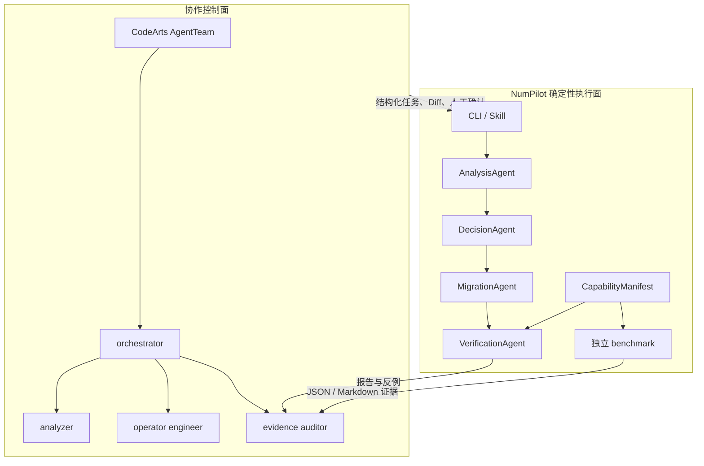
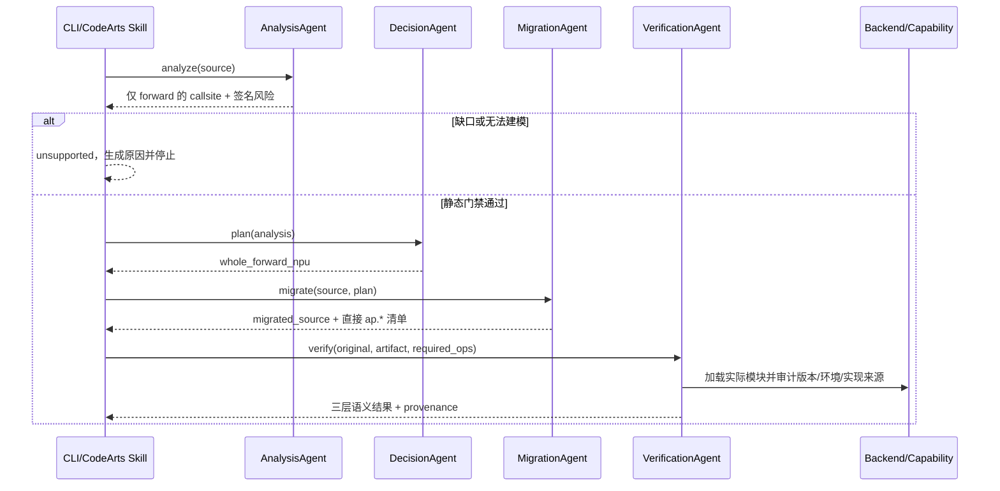

# NumPilot 当前架构

> 版本：demo hardening，2026-07-18。本文描述已经落地的行为，不把设计愿景写成现有能力。

NumPilot 当前解决的是一个受约束的迁移问题：识别顶层同步 `forward()` 中已建模的 NumPy 调用，把整个 `forward` 迁移为一个 AsNumpy 设备岛，并用产物级测试与执行来源证据判断结果能否被接受。它还不是通用的 CPU/NPU 图切分器，也没有完成缺口算子自动生成闭环。

## 1. 两层系统边界



- CodeArts 负责需求拆解、角色协作、过程展示和人工审批。
- NumPilot CLI、contracts、capability registry 和比较器负责可复现的工程动作及门禁。
- CodeArts 智能体不能用自然语言“确认执行在 NPU”；该结论只能来自版本绑定的 capability 与运行证据。

## 2. 迁移流水线



关键约束：

1. 只接受一个顶层同步 `forward()`；`build_inputs()` 和顶层展示代码不迁移。
2. AST 引擎只改写这个 `forward`，并在函数入口把 NumPy ndarray 幂等上传；设备数组和标量保持原样。
3. `DecisionAgent` 当前只产生 `whole_forward_npu`。保留的 `--threshold` 仅用于旧接口兼容，不制造尚未实现的数据流切分。
4. Python 二元/比较 dunder、未验证的 NumPy keyword、风险标量签名等会在分析阶段阻断。
5. LLM 引擎是 strict 策略：失败即失败，不静默回退 AST；其产物仍须通过同一静态和运行门禁。

strict 执行表面还要求 `forward` 是当前能够证明的直线设备数据流：不允许残留 NumPy/host escape、未知 helper、全局预计算或丢弃 `ap.*` 结果；同一规范输入和独立产物两条路径都必须实际执行全部静态 `ap.*` callsite。该 Python API trace 与版本化源码审计构成当前证据模型，但仍不能替代后续 profiler/kernel trace。

## 3. 三层语义验证

迁移产物必须被真实加载，并调用自身 `build_inputs()`。验证器保留 NumPy/Python RNG 状态，分别检查：

| 门禁 | 两侧输入 | 目的 |
|---|---|---|
| 输入生成一致性 | 原始与迁移产物各自的 `build_inputs` | 防止迁移器篡改测试数据 |
| 计算主体一致性 | 两个 `forward` 使用同一份规范输入 | 防止错误 forward 被补偿性输入掩盖 |
| 产物完整性 | 原始输出 vs 迁移产物自身 `build_inputs + forward` | 验证实际交付文件可独立运行 |

统一比较器先检查嵌套容器、shape 和 dtype。浮点按实际 dtype 使用 `atol + rtol * abs(reference)`，整数/布尔精确相等，并显式处理零参考、NaN 与 Inf。异常会落成结构化失败，而不是被吞掉。

当前 `asnumpy` 模块临时注入由进程内全局锁保护并可靠恢复，但用户代码尚未在 OS 子进程/沙箱中隔离；这仍是正式系统的 P0 安全项。

## 4. 执行来源与能力注册

`coverage.py` 只回答“静态名称是否已建模”；`capabilities.py` 回答更严格的问题：

- 实际 wheel 是否存在这个 API；
- 当前 AsNumpy 版本是否完成源码审计；
- 实现来源是 `native_npu`、`custom_npu`、`composite_npu`、host assisted、CPU fallback 还是 unknown；
- CANN、SoC、模块路径是否与证据绑定。

版本漂移、API 缺失、CPU fallback、host assisted 或 unknown 都不能发布 strict-NPU 性能数字。当前已审计版本中 `matmul/inner/outer` 是明确 CPU fallback，`dot/vdot/floor` 存在条件性 host/CPU 路径，`signbit` 包含 host 辅助。因此 MLP/GEMM 只能用于迁移诊断，不能充当 NPU GEMM 加速案例。

## 5. 性能证据链

性能比较拆成两个独立进程：

```text
bench-cpu → cpu_baseline.json + cpu_baseline.npy
bench-npu → provenance → 三层语义 → 基线一致性 → npu_benchmark.json
                                                       → benchmark_report.md
```

`bench-npu` 的当前 NPU 计时口径是“输入预驻留设备，排除 H2D，每轮包含递归 D2H 同步”；它既不是 kernel-only，也不是端到端。只有 provenance、三层语义和 CPU 基线全部通过时，`performance_valid=true` 并计算 speedup。`--allow-cpu-fallback` 仅继续诊断，永远不发布加速比。

## 6. 包结构与扩展点

```text
numpilot/
├── contracts.py          Agent 数据契约
├── coverage.py           静态 API 名称快照
├── capabilities.py       版本化 capability/provenance
├── comparison.py         统一语义比较器
├── module_injection.py   受锁保护的临时模块注入
├── agents/               analysis / decision / migration / verification
├── engines/              AST 与 strict LLM
├── backends/             shim 与真实 NPU adapter
├── orchestrator.py       确定性流水线
└── bench.py              独立性能评测和证据落盘
```

后端扩展需要实现 `ExecutionBackend` 及 capability manifest；迁移引擎扩展需要实现 `MigrationEngine`。任何新后端或引擎都不能绕过统一验证器。

## 7. 下一阶段

1. 建立 callsite/value 级 IR、shape guard 和真实数据流边界，再讨论 CPU/NPU 子图切分。
2. 把分析、构建和执行放入独立受限进程，收敛文件、网络和设备权限。
3. 将 H2D/D2H 字节、kernel trace、profiler artifact 纳入证据 schema。
4. 定义 GapSpec 与 OperatorArtifact 契约，接入 Ascend C 生成、构建、UT/ST、版本化注册和回滚。
5. 在 CodeArts 中先使用仓库级 Agent/Skill；稳定后再以白名单 MCP 暴露 `analyze/doctor/capabilities/migrate/verify`，不暴露任意 shell。
