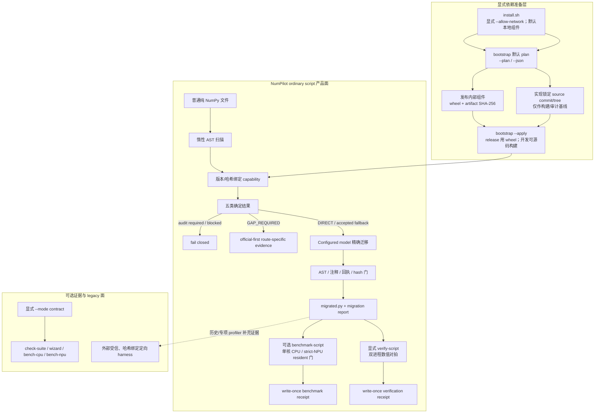
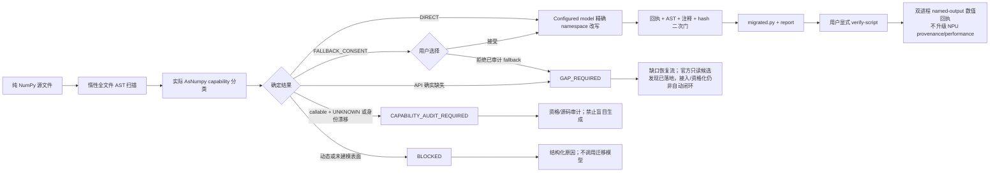

# NumPilot 当前架构

> 架构文档更新：2026-08-31；仓库公开 NPU 证据截至 2026-08-28。本文区分“已经落地的通用接口/
> 原语”“单个受限案例已经验证的路径”和“下一阶段自动闭环”，不把局部资格化外推成通用能力。

完整 v6 架构图：[中文 SVG](numpilot-zh-v6.svg) · [English SVG](numpilot-en-v6.svg)。
可机器审计边界图：[中文](assets/architecture/numpilot-architecture-zh.svg) ·
[English](assets/architecture/numpilot-architecture-en.svg)。可编辑版：
[中文 PPT](numpilot-zh.pptx) · [English PPT](numpilot-en.pptx)。单页图以实线标识已实现路径、以
虚线标识规划路径。缺口输出因路由而异：官方二进制通用链到 `CANDIDATE_READY`，仅已审计的
installed-ACLNN MatMul 定向切片到 `ADAPTER_CANDIDATE`，ops-nn 当前输出源码证据，固定 CANNBot
Skills 与 configured model 当前输出未验证算子草稿。

README 中的 v6 SVG 是完整展示版，文字已转为轮廓并内嵌了位图 Logo；文本化的边界图单独用于机器审计。
PPT 保留原稿几何与视觉风格，公开发布前仍需用 PowerPoint/WPS 人工检查字体替换、文本溢出和线型。
当前仓库中的中英文 PPT 是单页架构源文件，不能单独视为赛题要求的完整方案介绍材料；提交前应
另行拆分/补齐场景痛点、需求、CodeArts 五类使用记录、测试效果、部署和扩展性页面，并在目标
演示环境检查中文字体与投影可读性。

发布时 AsNumpy 是独立的、哈希绑定的内部运行时组件，不是浮动依赖。用户安装应只接收同一
release 的本地 wheel/受控制品；源码 checkout 和缓存仅用于隔离构建下一版。固定身份、历史
wheel 摘要、无隐式获取规则和升级/回滚合同见
[AsNumpy 内部组件锁定说明](ASNUMPY-INTERNAL-COMPONENT-LOCK.zh-CN.md)。当前 Alpha 代码仍保留
源码优先开发路径；发布/比赛 component 模式已完成本地 no-fetch、哈希和运行时画像门禁，源码
路径仍只能由维护者显式选择，不能混入用户安装流程。

NumPilot 当前默认解决一个直接问题：用户提交带 `import numpy as np` 的普通纯 NumPy 文件，
系统不执行源码，先检查实际 AsNumpy capability，再由用户配置模型生成受精确 AST/回执约束的迁移
文件。用户不需要为了迁移而增加 `build_inputs()` 或 `forward()`。

AST/runtime evidence 是事实层：定位绑定、枚举调用点并判断当前接口、签名和 provenance；模型
不是 capability 探测器。当前 ordinary 实现仍让 configured model 返回完整文件，再由 exact AST
证明它只实施授权 plan。目标架构会把可证明的纯 namespace/局部机械改写下沉为 AST 快路径，
把模型集中用于 API 组合、复杂语义，以及本项目的核心创新——缺口算子生成和 AsNumPy 工程接入。
两条路径最终使用同一证据与验证门，不能因生成者不同而降低标准。

reviewed official existing-module adapter 不用 AST 决定 C++/pybind/Python 的工程语义。
模型逐目标返回 `NUMPILOT_EXACT_EDIT_V1` 的最小 OLD→NEW 语义编辑；本地只校验
目标路径、base SHA-256、OLD 唯一性与区间不重叠，然后机械重建完整文件。
模型语义判断与本地精确重建的职责不得互换。

旧 `build_inputs + forward` 设备岛只保留为显式 `--mode contract` 的 legacy 严格通道。
`--mode auto` 仅用于兼容旧调用，不能出现在新的默认用户流程、比赛脚本或能力承诺中。

## 1. 三层边界



- bootstrap 只准备并核对锁定依赖，不决定迁移语义。
- 现场源码构建的 native hash 可因工具链而变化；capability 层会从默认或显式
  `NUMPILOT_BOOTSTRAP_RECEIPT` 路径严格复验 source/installed/verification 双向身份，并单独
  核对全部已审计 Python wrapper hash；不会仅凭 commit 文本放行。
- receipt 是当前用户边界内的本地 lineage/漂移门，不是签名供应链证明；不承诺对抗同一
  用户或 root 主动改写 receipt 与安装文件。
- ordinary script 扫描和迁移阶段不执行用户源码，但 `migrate` 会把完整源码发送给用户配置的远端
  模型。gap/operator 生成与修复会发送有界缺口合同、静态语义函数、选定 CANNBot Skill 上下文及
  适用的草稿/诊断；AsNumpy adapter 路径会发送按目标投影的源码/头文件、Skill 上下文、overlay 与
  诊断。CANNBot 提供工作流上下文，真正生成草稿的仍是 configured remote model。`verify-script`、
  `benchmark-script` 与演示会以当前用户权限执行原脚本和候选；`python -I` 不是 OS 沙箱，不可信
  输入必须使用独立容器或虚拟机。
- `verify-script` 已提供 hash-bound 的通用基础数值验证，但固定
  `strict_npu_verified=false`、`performance_valid=false`、`os_sandbox=false`。
- `benchmark-script` 已提供首版 ordinary strict-NPU resident 性能门：它只接受真实
  configured-model strict artifact，以 marker 划分一次输入准备和重复直线计算区，在两个独立
  单核 worker 中验证 BLAS 线程、runtime/profile、实际调用次数、逐样本同步与数值，再发布原始
  样本和 combined receipt。该命令不宣称任意 Python、kernel-only 或冷启动端到端能力。
- legacy contract 工具不能反向成为普通脚本的输入格式要求，也不能替代上述 artifact 证据。

## 2. 显式依赖准备层

依赖准备的已落地命令面是：

```bash
# 全新机器 direct 默认：只克隆 NumPilot，显式允许联网
./install.sh --allow-network \
  --persistent-root /absolute/platform-persistent/root
source /absolute/platform-persistent/root/activate-numpilot.sh

# 只有 gap/operator lane 才给 install.sh 增加：
# --with-cannbot --accept-cannbot-license

# 无模式和 --plan 都是只读；--json 输出机器可读计划
python -m numpilot bootstrap
python -m numpilot bootstrap --plan
python -m numpilot bootstrap --plan --json

# 冻结 release 用户路径：只安装同一 release 附件中的内部 AsNumpy wheel + manifest/hash
python -m numpilot bootstrap --apply \
  --asnumpy-component /secure/release/components/asnumpy \
  --receipt /secure/private/bootstrap-receipt.json

# 兼容/迁移路径：已有可信 wheel 时显式提供文件与 hash
python -m numpilot bootstrap --apply \
  --asnumpy-wheel /secure/release/components/asnumpy/asnumpy-<locked>.whl \
  --asnumpy-wheel-sha256 <release-manifest-sha256>

# 维护者开发/构建下一版的 direct 手工路径：从锁定 source commit/tree 构建（非现场安装）
python -m numpilot bootstrap --apply --build-asnumpy

# 可选 gap/operator lane：增加固定 CANNBot bundle
python -m numpilot bootstrap --apply --build-asnumpy \
  --with-cannbot --accept-cannbot-license

# 维护者手工准备 checkout；仍须满足精确 origin/commit/tree/clean 门禁
python -m numpilot bootstrap --apply --build-asnumpy \
  --asnumpy-cache /path/to/asnumpy \
  --with-cannbot --cannbot-cache /path/to/cannbot-skills \
  --accept-cannbot-license

# 非发布/兼容路径：本地 wheel 必须带来自可信发布物/用户输入的 hash
python -m numpilot bootstrap --apply \
  --asnumpy-wheel /trusted/path/asnumpy.whl \
  --asnumpy-wheel-sha256 "$TRUSTED_ASNUMPY_SHA256"

# 安装后复验当前环境；第二条还会从固定本地 bundle 输出 Ascend C Skill 清单
python -m numpilot bootstrap --verify
python -m numpilot bootstrap --verify --with-cannbot --accept-cannbot-license
```

命令的行为约束如下：

1. 无模式或 `--plan` 只读环境和动作计划，不 clone、fetch、build 或 install；
2. `--apply` 必须在受控 `--asnumpy-component PATH`、成对的
   `--asnumpy-wheel PATH --asnumpy-wheel-sha256 HEX` 和 `--build-asnumpy` 之间三选一；
   `--receipt PATH` 可指定原子回执位置，但必须是绝对路径，
   且其父目录由当前用户拥有、不是符号链接、不可被 group/world 写入；
3. 实现内锁定 official AsNumpy source commit/tree，源码构建只能由显式
   `--build-asnumpy` 触发；手工路径必须先安装 `numpilot[bootstrap]`，
   `bootstrap --apply` 不会自动从 PyPI 补齐。顶层 `install.sh` 只在用户给出
   `--allow-network` 后创建项目 venv、安装 `.[bootstrap]`，先生成/source activation，再编排
   plan/apply/verify/doctor；
   上游构建尚无 OS 级断网沙箱，因此 plan 对 build 动作保守标记 `network=true`，即使源码
   cache 已存在也不会声称离线保证；
4. 实现不内置 wheel URL 或 expected wheel hash。本地 wheel 的预期 SHA-256 来自
   可信发布物或用户输入，安装前校验，实际 hash 写入 receipt；
5. 开发机默认可从锁定源码构建，不使用 wheelhouse；冻结 release 则必须使用
   component manifest/release manifest 绑定的内部 wheel，禁止在缓存缺失时获取源码。预编译 wheel 的
   tag、metadata、RECORD、安装后 module/native hash 与实际版本都会进入 receipt，未知
   wheel 即使 hash 匹配用户输入，也仍需后续 qualification；
6. CANNBot official commit/bundle 身份在实现中固定；只有显式
   `--with-cannbot` 获取或复验其内容时才要求 `--accept-cannbot-license`。单独准备 AsNumpy
   不要求 CANN Open Software License Agreement（CANN OSL）；
7. `--asnumpy-cache PATH` 和 `--cannbot-cache PATH` 只用于显式指定锁定 checkout
   缓存；不放宽 origin/commit/tree/hash 校验；
8. `--verify` 使用隔离 Python 进程执行 AsNumpy 官方 README 的 `ap.ones((1000, 1000),
   dtype=ap.float32)` 形状 smoke，并核对实际版本、模块路径和 native hash；带
   `--with-cannbot` 时还会本地回答“现在写 Ascend C 算子有哪些能参考的 Skill？”并列出固定
   bundle 中已校验的 Skill，不发起模型或网络请求；
9. 默认 receipt 位于 NumPilot XDG 状态目录。installer 会在 bootstrap 前原子生成并 source
   无凭据 activation，让安装验收与后续 shell 使用同一 venv、config/state/cache/receipt、CANN
   和可选 CANNBot exact checkout；只有 verify/doctor 通过后才打印 ready。
   source 两次会去重并清理冲突 toolkit/devlib。自定义 `--receipt` 的后续进程必须使用同一
   路径；运行时不扫描 cwd，receipt 或
   wrapper/native/module/interpreter/package 身份任一漂移都 fail closed；
10. NumPilot 不得通过 pip 安装钩子、`import`、`doctor`、`migrate` 或
   `complete-gaps` 隐式下载依赖。ordinary `migrate` 调用已配置模型是用户请求的模型动作，
   不是依赖安装；它必须保留远端回执，且只在调用进程临时使用用户配置的代理。
11. release 模式还要把内部 AsNumpy wheel 的字节、METADATA/RECORD、安装后 Python/native
    模块哈希写入同一 release manifest；任一缺失或漂移都返回阻断，不能切回 `--build-asnumpy`
    或自动下载源码。

## 3. 默认 ordinary script 流程



五类结果的含义是：

| 结果 | 条件 | 下一步 |
|---|---|---|
| `DIRECT` | 所有使用均在当前 runtime/audit 的 strict 或受限 qualified 范围 | 调用已配置模型，随后做精确本地审计 |
| `FALLBACK_CONSENT` | 已审计为 CPU、conditional CPU 或 host-assisted | 等待用户接受、拒绝或终止；非交互环境不默认接受 |
| `GAP_REQUIRED` | API 确实缺失，或用户拒绝已审计 fallback | 生成 source/callsite/SoC/CANN 绑定的 GapSpec |
| `CAPABILITY_AUDIT_REQUIRED` | callable 但 provenance 为 `UNKNOWN`，或 runtime/version/hash/path 尚未审计 | 先资格化或源码审计，不生成同名替代算子 |
| `BLOCKED` | 动态 alias、未建模 operator/method/nested path、签名或 Python 表面无法安全处理 | 失败关闭并记录原因 |

普通脚本当前要求一个顶层 `import numpy as np`，并对 alias 重绑定、动态 `np`、星号实参、
未审计 Python 数组运算符、ndarray method 和 nested namespace 失败关闭。函数、类或控制流的
存在本身不构成支持承诺；只有整个文件的具体执行表面通过扫描才可继续。

模型输出必须来自通过 `openai-chat-completions` 合同验证的精确 configured model，只允许
source-bound 改写计划。响应 model 默认精确匹配，alias 必须显式 allowlist；完整 AST、注释、
模型身份、内容 hash 和远程回执任一不一致都拒绝发布；本地 transformer 只是比较 oracle，不能
作为模型失败时的迁移产物。

普通脚本 run 是 write-once：`migrated.py`、`gap-request.json` 和
`script-migration-report.json` 不得与历史 run 混用。迁移报告固定如实写明是否执行、是否完成
数值验证和性能是否有效。

迁移后的 `verify-script` 是另一条显式事务：它重新校验 report/source/migrated 三者绑定，
对已校验字节做快照，在两个 `python -I` 子进程中执行，并只通过无 pickle 的有界 numeric/bool
named-output 合同回传结果。verification receipt 单独 write-once 落盘，不回写或提升 migration
report。它记录 worker、解释器和 NumPy/AsNumPy 模块身份，但只证明数值一致；完整合同见
[Ordinary script 数值验证](script-verification.md)。

性能是第三条显式事务。`benchmark-script` 重新执行同一 source/report/migrated 绑定，对
marker 两侧分别做 namespace-normalized AST 等价检查；prefix 只执行一次，suffix 默认预热 3 次、
采样 20 次，NPU 每次前后同步，最终每个命名输出只做一次 D2H。任何 strict provenance、亲和性、
线程、调用次数、同步或数值门失败都发布 `performance_valid=false` 且省略 speedup。headline 是
steady device-resident suffix；prefix、最终 D2H 和暖运行组件和另列。完整合同见
[Ordinary script strict-NPU resident benchmark](script-benchmark.md)。

## 4. 缺口恢复与资格化状态

当前已经存在的原语包括：

- source-bound GapSpec 和 generation request；
- CANNBot bundle 校验、configured-model draft generation、诊断驱动 repair 和离线 seal；
- AsNumpy adapter generation/repair；
- 六门 qualification evidence schema、capability overlay 与 runtime guard。
- source/target/runtime/policy 不可变绑定、逐 gap reducer、write-once SHA-256 状态链，以及
  official binary / official source / remote model 的 route-neutral candidate 合同；
- schema-2 typed stage receipts，以及把 migration report、GapSpec request、official resolution
  严格接到 `CREATED → ANALYZED → GAP_PREPARED → RESOLVED` 的离线 ingest；
- installed `official_binary` 的 fresh candidate materializer，以及 reviewed `numpy.matmul`
  existing-module adapter 的 schema-4 model producer 和 `ADAPTER_CANDIDATE` receipt ingest。

adapter 上下文不再假定单一源码布局。`asnumpy_adapter_context.py` 会在任何模型调用前只读识别
`manifest_generator`、固定 `1929a3...` 源树使用的 `legacy_manual`，或当前仅审计 MatMul 的
`official_aclnn_existing_module` 架构，校验最多 8 个真实
参考文件的边界、类型、大小和 SHA-256，并给出严格 overlay allow-list。official plan
使用 schema 2 `prompt_dependencies`，每个目标只能引用 `reference`、
`signed_official_header` 或 `generated_overlay` 三类来源。MatMul 的固定映射为：
`product.cpp ← product.hpp + SIGNED_OFFICIAL_HEADER/aclnn_matmul.h`、
`direct.py ← bind_linalg.cpp + utils.py + bind_utils.cpp`，以及
`test_product.py ← generated_overlay/direct.py`。schema-2 mapping 和 context hashes 共同进入
`plan_sha256`；完整上下文是本地 trust root，不会整包发送给模型。

每个模型请求只带该目标的 hash-bound 投影，并嵌入 content-free projection
manifest；manifest 记录依赖的 SHA-256、provenance 和 `projection_sha256`。
`generated_overlay` 依赖还绑定 rebuilt/base/response hashes 及其 producer receipt 的
request/response hashes，不能只凭一个相对路径被后续目标信任。system + user messages
总包络限制为 64 KiB，remote receipt 的 `request_body_sha256` 绑定实际请求体。
generation 与 repair 都会把 `architecture/mode/plan_sha256` 写入 preflight；本地输入或布局
无效时不会进行模型 readiness 探测。official 模型门初始为 false；只有
candidate、GapSpec、decision、mapping/header/library/symbol/semantic-review refs 和 reviewed
context plan 全部复验后才打开。

reviewed MatMul 的 target edit windows 也是本地信任合同：`product.cpp` 的编辑必须
全部位于 Matmul 函数内，`test_product.py` 的编辑必须全部位于 imports/helpers
或 matmul 测试段内，OLD 不得跨越任何窗口边界。真实 GLM exact route 通过严格
SSE 事件聚合取得内容，请求固定 thinking disabled 和 reasoning minimal；仅当聚合后
`content` 为空时，才将响应预算从 8192 升到 16384 重试，非空但违约的内容仍直接
失败关闭。本轮真实端点验收产生 5 份成功 remote receipts，并只把状态推进到
`ADAPTER_CANDIDATE`；build/execution/activation 都没有发生。

状态控制面当前能把 installed binary 逐 gap 推进到 `CANDIDATE_READY`，并把 reviewed MatMul
的未验证 overlay 推进到 `ADAPTER_CANDIDATE`。后续仍未自动执行：

```text
integrate → qualify → activate → rescan → final configured-model migration → verify
```

`candidate-generation` profile 的已实现链路严格终止于 `ADAPTER_CANDIDATE`，它只允许
subprocess/network/model，不允许 system write、AsNumPy import、build、execution 或
activation。只有 run 在首次 ingest 时就冻结为 `full-local-recovery`，才能授权未来的
本地集成、构建、验证和激活 producer；这些 producer 当前尚未自动接线。profile 不能
途中升级，“被授权”也不等于“已执行”。

2026-08-27 的 `numpy.matmul` 案例已由外部受信编排把这条链路完整走通一次：旧运行时先生成
GapSpec，resolver 命中 installed ACLNN 并固定 ops-nn v9.0.0 来源，AsNumPy 公开 API 接入后
通过精确 runtime/receipt 门禁，最终由 configured model 生成迁移产物并在真实 NPU 上封死
宿主回退执行。它是二维、非空、C 连续、双 `float32` 输入的定向证明，不表示通用自动编排器
已经实现，也不放宽其他 dtype/rank/broadcast 合同。

在生成新 kernel 之前，当前设计固定先检查已安装 CANN 的 ACLNN 候选，再检查与当前 CANN
版本匹配、固定身份的本地官方 [`cann/ops-nn`](https://gitcode.com/cann/ops-nn) 源码：

```text
GapSpec
  → 已安装 CANN ACLNN 只读候选查询
    ├─ 候选：语义审计 → configured model 返回逐目标 exact edits
    │         → 本地精确重建未验证 AsNumpy adapter candidate
    ├─ clean no_match：继续查询本地固定 ops-nn
    └─ incompatible / ambiguous / error：失败关闭
  → 固定 CANN 版本的本地 ops-nn Git object 只读查询
    ├─ 候选 / 歧义：当前只发布源码发现证据；物化、构建与 adapter 接线尚未实现
    ├─ clean no_match：才进入 CANNBot Skill + configured model 新 kernel generation
    └─ incompatible / ambiguous / error：失败关闭
  → 仅 full-local-recovery 可授权未来 integrate / 六门 qualification / activate / rescan
```

已落地的 `installed_cann.py` 只读取显式 CANN 根目录，核对版本、header、共享库 hash 和
ACLNN 动态符号；它不 import CANN、不加载共享库。`official_source.py` 只读取本地 Git 对象，
当前把本机 CANN 9.0.0 固定到 `refs/tags/v9.0.0`、commit
`0413e303e6cd1986b592c3e039f2579ac0f10b62`、tree
`827d73df88f73353821b63ed4e0d1711b6d2cb50`，不会切换工作树、联网或构建。两个 resolver
都只产生候选发现证据，`activation_allowed` 固定为 false；名称、header、符号或目录命中均
不等价于语义合格。

`official_resolution.py` 已把两个只读 resolver 串成 official-first 路由；`resolve-gaps` 会生成
绑定 source/GapSpec/CANN/SoC/provider evidence 的 write-once `0600` 收据。
`complete-gaps --official-resolution-report` 在任何模型 readiness 或 CANNBot Skill 读取前复验
收据，并重新盘点当前 CANN/ops-nn 证据、要求 `resolution_id` 与收据一致；只有全部 Gap 的
两层结果都是 clean `no_match` 才允许新 kernel generation。候选、证据漂移、歧义、不兼容、
错误或收据篡改均失败关闭。有 Gap 的 `--provider llm` 未提供收据时会在模型/Skill 前返回
非零，official-first 证明已经是新 kernel 路径的强制门禁；无 Gap 时仍直接本地结束，不做模型
readiness 探测。

对于源码中明确声明的领域 `OperatorSpec`，另有一个必须显式开启的
`--allow-custom-operator-generation` draft-only 路由。它只接受
`provenance=custom_generation_candidate` 且 `route=ascendc_registry_candidate` 的静态契约，
并把 `custom_operator_generation_allowed` 与
`custom_generation_proof.official_equivalence=not_proven` 写入官方解析收据；
`catalog_unreviewed_api` 仍保持 `ambiguous`，不会被伪装成 clean `no_match`。已发现的官方
候选、非 OperatorSpec 缺口、身份漂移和错误状态不能被该开关覆盖。即使该路由获准，仍须
配置模型、代理、固定 CANNBot Skill 和后续六门资格化；产物永远先是
`generated_unverified`，恢复/激活流程不会把它当作已验证能力。

`recover-gaps ingest-official` 对 schema-2 gap migration report、其 sibling
`gap-request.json` 和上述 official resolution 做严格 bounded JSON 解析与全交叉绑定，再以每阶段
新增、parent/binding/coverage/kind 精确匹配的 typed receipt 幂等推进到 `RESOLVED`。它固定
`receipt_ingestion_only=true`、`current_environment_recheck=false`，所有副作用真值为 false。
首次创建 run 时只允许选择冻结的 `receipt-only`、`candidate-generation` 或
`full-local-recovery` profile；授权不等于已经发生副作用，也不能在续接时升级：

```bash
python -m numpilot recover-gaps ingest-official /absolute/path/to/source.py \
  --migration-report /absolute/private/run/script-migration-report.json \
  --gap-request /absolute/private/run/gap-request.json \
  --official-resolution-report /absolute/private/run/official-resolution.json \
  --state-dir /absolute/private/run/recovery \
  --authorization-profile candidate-generation --json

python -m numpilot recover-gaps materialize-candidates \
  --state-dir /absolute/private/run/recovery \
  --out /absolute/private/run/candidates --json

python -m numpilot generate-asnumpy-adapter \
  --candidate /absolute/private/run/candidates/gaps/GAP/operator-candidate.json \
  --recovery-state-dir /absolute/private/run/recovery \
  --asnumpy-reference /absolute/path/to/pinned/asnumpy \
  --out /absolute/private/run/adapter

python -m numpilot recover-gaps ingest-adapter \
  --state-dir /absolute/private/run/recovery \
  --candidate /absolute/private/run/candidates/gaps/GAP/operator-candidate.json \
  --adapter-output /absolute/private/run/adapter --json

python -m numpilot recover-gaps status \
  --state-dir /absolute/private/run/recovery --json
```

installed candidate producer 会 fresh 重跑 resolver、比对 `resolution_id`、重哈希 header/library，
再以五类 adapter refs 和 external installed-CANN terms 发布 write-once candidate；它不把 ops-nn
CANN OSL 冒充 installed toolkit 接受记录。`official_source`/`remote_llm` materializer 仍失败关闭。

AsNumpy adapter generation/repair 使用 schema 4 report/receipt，将检测到的
`manifest_generator`/`legacy_manual`/`official_aclnn_existing_module` architecture、参考根目录、context hashes、完整 overlay
路径集合及 repair parent 绑定；official context plan 在该现有字段内为 schema 2，不增加
report schema 或顶层字段。official generation 的模型回复是 `NUMPILOT_EXACT_EDIT_V1`，
本地拒绝空文件、超限文件和 placeholder，并将机械重建后的完整文件及哈希写入
schema-4 report 和 remote receipts。任一上下文漂移都会在模型和 Skill 读取前要求重新生成。
`ingest-adapter` 自身离线，但会把已复验 provider receipt 中真实发生的 model/network effect 写入
Recovery；build/integration/import/execution/verification/activation 仍为 false。

```bash
python -m numpilot resolve-gaps examples/gap_cbrt.py \
  --out /absolute/private/run/official-resolution.json \
  --target-soc Ascend910B4 --cann-version 9.0.0 \
  --cann-root /absolute/path/to/cann-9.0.0 \
  --ops-nn-root /absolute/path/to/ops-nn \
  --accept-cann-osl

python -m numpilot complete-gaps examples/gap_cbrt.py \
  --out /absolute/private/run/gap-output \
  --target-soc Ascend910B4 --cann-version 9.0.0 \
  --provider llm \
  --official-resolution-report /absolute/private/run/official-resolution.json
```

当前 installed ACLNN catalog 只审计精确的 `Ascend910B4`。`Ascend910B` 是 family 名称，
会在盘点 toolkit/ops-nn 前失败关闭；其他精确型号需要各自的审计记录，不能类推。

该路径不能放进默认安装：使用/构建 ops-nn 前必须显式接受 CANN OSL，固定 official
origin/commit/tree/file hashes，避免全量构建和系统 OPP 覆盖。未来构建必须进入隔离目录与
私有 OPP，带安装清单和回滚路径；resolver、`import`、`doctor`、`migrate` 和
`complete-gaps` 均不得隐式联网或写系统 OPP。mutation、返回值、参数默认值、broadcast、
dtype、shape、layout 和异常边界仍须逐项对照 GapSpec。

installed `official_binary` candidate 已有 hash-bound Artifact/adapter 输入；现有 qualification
尚未消费它。仍须新增不会伪装成 `remote_llm` 的 `official_source` Artifact/manifest，并扩展
integration/qualification validator。
六门固定为 artifact integrity、build、UT、NumPy numerical、public AsNumpy API 和真实 NPU
execution；activation 是之后的独立状态。
详细状态与授权边界见
[Gap 恢复状态合同](gap-recovery-state.md)，可编辑三页图见
[官方算子解析与缺口恢复架构图](numpilot-official-operator-resolution.drawio)。

自定义算子补全的分支、`OperatorSpec` 静态合同、CANNBot/模型草稿边界、隔离接入和六门资格化
见[AsNumpy 自定义算子补全静态流程图](numpilot-asnumpy-custom-operator-flow.png)；对应的
[固定坐标 draw.io 源文件](numpilot-asnumpy-custom-operator-flow.drawio)不使用自动布局。图中将
`generated_unverified`、`ADAPTER_CANDIDATE` 与后续（标注为 `target/manual` 的）
`QUALIFIED`/`ACTIVATED` 状态明确分开。

因此代码中的唯一状态名必须逐级如实记录：

```text
created → analyzed → gap_prepared → resolved
  → candidate_ready
  → adapter_candidate
  → integrated_candidate
  → qualified
  → activated
  → rescanned
  → final_migrated
  → verified
```

通用 provider 路径通常只产生 `prepared` 或 `generated_unverified`。Recovery 的 installed
ACLNN 路线当前可到 `CANDIDATE_READY`，reviewed MatMul 可把未验证 adapter 绑定到
`ADAPTER_CANDIDATE`；pinned ops-nn resolver 仍只提供发现证据，CANNBot 产物也不会自动成为
adapter。MatMul 案例另行完成了
installed-ACLNN adapter、六门 qualification、精确 runtime activation、rescan 和最终迁移，
但没有实现可复用于任意候选的 `official_source` Artifact、定向构建/私有 OPP 或统一 runner。
adapter 与 qualification/overlay 仍是可独立调用的安全原语，不是通用自动恢复流。
封存不等于构建通过，resolver candidate 不等于已接入，qualification schema 存在也不等于
六门已经通过。

只有 missing API 或用户拒绝的 audited fallback 可以生成 gap。callable + `UNKNOWN` 必须进入
capability/source audit；旧 fallback runtime 不能被 overlay 直接重命名为 NPU 实现。完成独立
接入和激活后，还必须重新扫描原文件，再由 configured model 生成最终迁移文件。该自动恢复编排属于下一阶段。

## 5. 显式 legacy contract 通道

legacy 通道只能显式进入：

```bash
python -m numpilot migrate task.py --mode contract --engine llm
```

它保留 AnalysisAgent → DecisionAgent → MigrationAgent → VerificationAgent：

1. 要求唯一顶层同步 `build_inputs()` 和 `forward()`；
2. 只迁移 `forward()`，输入构造与顶层展示留在 CPU；
3. `DecisionAgent` 只产生 `whole_forward_npu`，不宣称通用 CPU/NPU 子图切分；
4. `check-suite`、`wizard`、`bench-cpu`、`bench-npu` 都属于这条 legacy contract 工具链；
5. 比赛案例仍必须使用 strict LLM；AST 只保留给框架离线回归。

### 5.1 Legacy contract 的三层语义门

| 门禁 | 两侧输入 | 目的 |
|---|---|---|
| 输入生成一致性 | 原始与迁移产物各自的 `build_inputs` | 防止迁移器篡改测试数据 |
| 计算主体一致性 | 两个 `forward` 使用同一份规范输入 | 防止错误 forward 被补偿性输入掩盖 |
| 产物完整性 | 原始输出 vs 迁移产物自身 `build_inputs + forward` | 验证 contract 文件可独立运行 |

这些门只描述 legacy contract，不能与 ordinary `verify-script` 的 named-output 合同混写；
后者也不能反向宣称 legacy strict-NPU/profiler/benchmark 能力。

## 6. 能力与证据边界

`coverage.py` 只回答“静态名称是否已建模”；`capabilities.py` 和 NPU backend 还必须回答：

- 当前 wheel 是否暴露 API；
- version、文件和二进制 hash 是否匹配审计身份；
- provenance 是 native/custom/composite NPU、host-assisted、CPU fallback 还是 unknown；
- 调用签名、dtype/rank/layout/numel profile 与 CANN/SoC 是否落在证据范围。

通用基线 wheel 中 `matmul/inner/outer` 是已知 CPU fallback；P0 move wheel 只有在精确 runtime
身份和绑定的 float32/rank/profile 范围内，才可放行已审计的 `outer/matmul` NPU 路径。二者不
矛盾，也不能相互扩大能力声明。版本漂移、CPU fallback、host-assisted 或 unknown 都不能发布
strict-NPU 性能数字。

ordinary `benchmark-script` 的强 NPU evidence 必须绑定：

- 原始源码、迁移 report/artifact 与 runner/worker hash；
- AsNumpy wheel、capability audit/overlay、CANN 和 SoC 身份；
- 数值 oracle、实际 NPU 调用/deny-fallback 证据和明确计时口径。

产品内基础 ordinary 数值验证与受限 resident benchmark 均已实现；前者不验证 NPU provenance
或性能，后者不外推到任意 Python、profiler 或冷启动端到端。legacy `bench-cpu/bench-npu` 只对其 contract 输入和由该链生成的产物负责；
它们不得重新迁移普通 artifact 后冒充同一证据。

当前比赛默认例子是 `examples/poisson_source_smooth_l1_map.py`；根目录 `run_demo.sh` 编排
五态分析、真实 configured model、数值门和产品 benchmark。公开发布内容只保留
[Poisson 应用阶段](../evidence/competition-poisson-stage-20260828/README.md)与
[逐元素优势区间](../evidence/competition-ordinary-20260828/README.md)两份当前证据。

## 7. 包结构与当前扩展点

```text
numpilot/
├── __main__.py            ordinary/legacy CLI 与显式用户门
├── bootstrap.py           只读 plan、锁定依赖 apply 与原子 receipt
├── script_migration.py   ordinary 扫描、分类、model/AST 门和报告
├── script_verification.py ordinary 双进程数值验证、hash/runtime 记录与回执
├── _script_verification_worker.py 私有无 pickle 执行 worker
├── script_benchmark.py  ordinary strict-NPU resident 父门、统计与 combined receipt
├── _script_benchmark_worker.py 私有单核/runtime/profile/同步性能 worker
├── capabilities.py       版本化 capability/provenance
├── backends/             shim 与真实 NPU runtime adapter
├── gaps/                 spec、draft/repair、adapter、qualification、overlay 原语
│   ├── recovery.py       不可变 binding、阶段 reducer、hash-chain 与候选来源合同
│   ├── recovery_ingest.py 前三段 producer receipt 严格导入与幂等续接
│   ├── candidate_materializer.py installed official_binary fresh candidate producer
│   ├── official_adapter.py official candidate/context/model gate
│   └── adapter_recovery.py reviewed MatMul adapter receipt 与幂等续接
├── contracts.py          legacy agent 数据契约
├── agents/               legacy analysis / decision / migration / verification
├── engines/              legacy AST 与 strict LLM engine
├── orchestrator.py       legacy contract 编排
└── bench.py              legacy contract 性能评测
```

下一阶段保持 bootstrap、`verify-script`、`benchmark-script` 和 recovery state 契约稳定；补齐
`official_source`/`remote_llm` candidate、其他 API/route adapter，再驱动
integrate/qualify/activate/rescan/final-migrate，并让最终 artifact
进入同一数值门。通用图 IR、
CPU/NPU 自动切分和通用 profiler runner 不属于当前切片。
