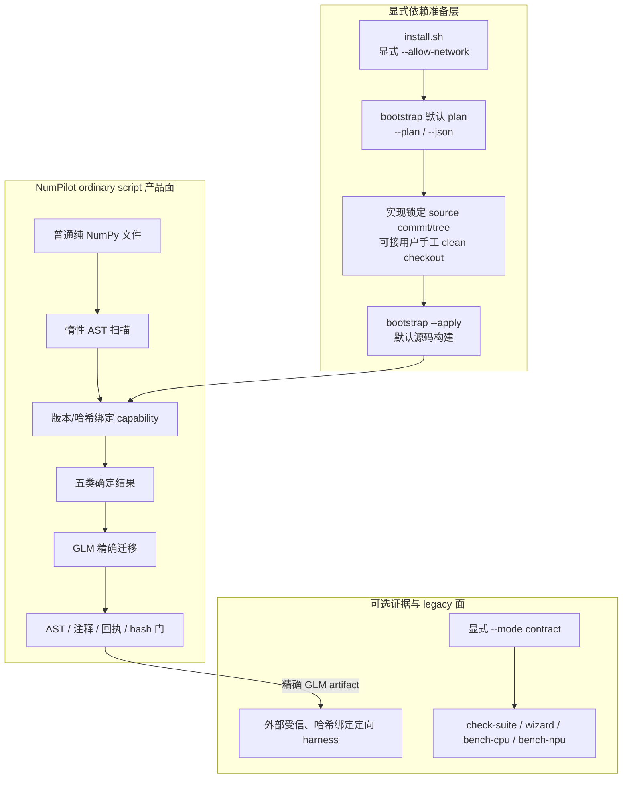
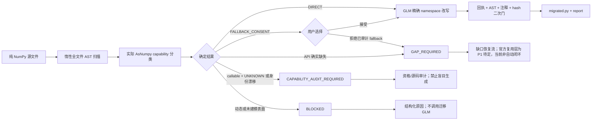

# NumPilot 当前架构

> 版本：Demo v1 ordinary-script 收口，2026-08-25。本文区分“已经落地的接口/原语”
> 和“下一阶段闭环”，不把设计目标写成当前能力。

NumPilot 当前默认解决一个直接问题：用户提交带 `import numpy as np` 的普通纯 NumPy 文件，
系统不执行源码，先检查实际 AsNumpy capability，再由 GLM 生成受精确 AST/回执约束的迁移
文件。用户不需要为了迁移而增加 `build_inputs()` 或 `forward()`。

旧 `build_inputs + forward` 设备岛只保留为显式 `--mode contract` 的 legacy 严格通道。
`--mode auto` 仅用于兼容旧调用，不能出现在新的默认用户流程、比赛脚本或能力承诺中。

## 1. 三层边界



- bootstrap 只准备并核对锁定依赖，不决定迁移语义。
- 现场源码构建的 native hash 可因工具链而变化；capability 层会从默认或显式
  `NUMPILOT_BOOTSTRAP_RECEIPT` 路径严格复验 source/installed/verification 双向身份，并单独
  核对全部已审计 Python wrapper hash；不会仅凭 commit 文本放行。
- receipt 是当前用户边界内的本地 lineage/漂移门，不是签名供应链证明；不承诺对抗同一
  用户或 root 主动改写 receipt 与安装文件。
- ordinary script 扫描和迁移阶段都不执行用户源码。
- 产品内尚未实现 ordinary script 的通用 benchmark。当前比赛中的真实 NPU 数值/性能证据
  由外部受信、与原文件、GLM artifact、运行时及 harness 哈希绑定的定向流程提供。
- legacy contract 工具不能反向成为普通脚本的输入格式要求，也不能替代上述 artifact 证据。

## 2. 显式依赖准备层

依赖准备的已落地命令面是：

```bash
# 全新机器默认：只克隆 NumPilot，显式允许联网和接受 CANNBot 许可证
./install.sh --allow-network \
  --with-cannbot --accept-cannbot-license

# 无模式和 --plan 都是只读；--json 输出机器可读计划
python -m numpilot bootstrap
python -m numpilot bootstrap --plan
python -m numpilot bootstrap --plan --json

# 默认手工路径：从实现锁定的 official source commit/tree 构建
python -m numpilot bootstrap --apply --build-asnumpy \
  --with-cannbot --accept-cannbot-license

# 用户手工准备两个 checkout；仍须满足精确 origin/commit/tree/clean 门禁
python -m numpilot bootstrap --apply --build-asnumpy \
  --asnumpy-cache /path/to/asnumpy \
  --with-cannbot --cannbot-cache /path/to/cannbot-skills \
  --accept-cannbot-license

# 可选历史路径：本地 wheel 必须带来自可信发布物/用户输入的 hash
python -m numpilot bootstrap --apply \
  --asnumpy-wheel /trusted/path/asnumpy.whl \
  --asnumpy-wheel-sha256 "$TRUSTED_ASNUMPY_SHA256"

# 安装后复验当前环境；第二条还会从固定本地 bundle 输出 Ascend C Skill 清单
python -m numpilot bootstrap --verify
python -m numpilot bootstrap --verify --with-cannbot --accept-cannbot-license
```

命令的行为约束如下：

1. 无模式或 `--plan` 只读环境和动作计划，不 clone、fetch、build 或 install；
2. `--apply` 必须在 `--asnumpy-wheel PATH --asnumpy-wheel-sha256 HEX` 和
   `--build-asnumpy` 之间二选一；`--receipt PATH` 可指定原子回执位置，但必须是绝对路径，
   且其父目录由当前用户拥有、不是符号链接、不可被 group/world 写入；
3. 实现内锁定 official AsNumpy source commit/tree，源码构建只能由显式
   `--build-asnumpy` 触发；手工路径必须先安装 `numpilot[bootstrap]`，
   `bootstrap --apply` 不会自动从 PyPI 补齐。顶层 `install.sh` 只在用户给出
   `--allow-network` 后创建项目 venv、安装 `.[bootstrap]` 并编排 plan/apply/verify/doctor；
   上游构建尚无 OS 级断网沙箱，因此 plan 对 build 动作保守标记 `network=true`，即使源码
   cache 已存在也不会声称离线保证；
4. 实现不内置 wheel URL 或 expected wheel hash。本地 wheel 的预期 SHA-256 来自
   可信发布物或用户输入，安装前校验，实际 hash 写入 receipt；
5. 全新机器 Demo 默认从锁定源码构建，不使用 wheelhouse。预编译 wheel 只保留为
   显式高级/历史路径；wheel tag、metadata、RECORD、安装后 module/native hash 与
   实际版本都会进入 receipt，未知 wheel 即使 hash 匹配用户输入，也仍需后续
   qualification；
6. CANNBot official commit/bundle 身份在实现中固定；只有显式
   `--with-cannbot` 获取或复验其内容时才要求 `--accept-cannbot-license`。单独准备 AsNumpy
   不要求 CANN Open Software License Agreement（CANN OSL）；
7. `--asnumpy-cache PATH` 和 `--cannbot-cache PATH` 只用于显式指定锁定 checkout
   缓存；不放宽 origin/commit/tree/hash 校验；
8. `--verify` 使用隔离 Python 进程执行 AsNumpy 官方 README 的 `ap.ones((1000, 1000),
   dtype=ap.float32)` 形状 smoke，并核对实际版本、模块路径和 native hash；带
   `--with-cannbot` 时还会本地回答“现在写 Ascend C 算子有哪些能参考的 Skill？”并列出固定
   bundle 中已校验的 Skill，不发起模型或网络请求；
9. 默认 receipt 位于 NumPilot XDG 状态目录。自定义 `--receipt` 的后续进程必须用
   `NUMPILOT_BOOTSTRAP_RECEIPT` 指向同一绝对路径；运行时不扫描 cwd，receipt 或
   wrapper/native/module/interpreter/package 身份任一漂移都 fail closed；
10. NumPilot 不得通过 pip 安装钩子、`import`、`doctor`、`migrate` 或
   `complete-gaps` 隐式下载依赖。ordinary `migrate` 调用已配置 GLM 是用户请求的模型动作，
   不是依赖安装；它必须保留远端回执，且只在调用进程临时使用用户配置的代理。

## 3. 默认 ordinary script 流程



五类结果的含义是：

| 结果 | 条件 | 下一步 |
|---|---|---|
| `DIRECT` | 所有使用均在当前 runtime/audit 的 strict 或受限 qualified 范围 | 调用 GLM，随后做精确本地审计 |
| `FALLBACK_CONSENT` | 已审计为 CPU、conditional CPU 或 host-assisted | 等待用户接受、拒绝或终止；非交互环境不默认接受 |
| `GAP_REQUIRED` | API 确实缺失，或用户拒绝已审计 fallback | 生成 source/callsite/SoC/CANN 绑定的 GapSpec |
| `CAPABILITY_AUDIT_REQUIRED` | callable 但 provenance 为 `UNKNOWN`，或 runtime/version/hash/path 尚未审计 | 先资格化或源码审计，不生成同名替代算子 |
| `BLOCKED` | 动态 alias、未建模 operator/method/nested path、签名或 Python 表面无法安全处理 | 失败关闭并记录原因 |

普通脚本当前要求一个顶层 `import numpy as np`，并对 alias 重绑定、动态 `np`、星号实参、
未审计 Python 数组运算符、ndarray method 和 nested namespace 失败关闭。函数、类或控制流的
存在本身不构成支持承诺；只有整个文件的具体执行表面通过扫描才可继续。

GLM 输出必须来自配置的 `glm-*` 模型，只允许 source-bound 改写计划。完整 AST、注释、模型
身份、内容 hash 和远程回执任一不一致都拒绝发布；本地 transformer 只是比较 oracle，不能
作为模型失败时的迁移产物。

普通脚本 run 是 write-once：`migrated.py`、`gap-request.json` 和
`script-migration-report.json` 不得与历史 run 混用。迁移报告固定如实写明是否执行、是否完成
数值验证和性能是否有效。

## 4. 缺口恢复与资格化状态

当前已经存在的原语包括：

- source-bound GapSpec 和 generation request；
- CANNBot bundle 校验、GLM draft generation、诊断驱动 repair 和离线 seal；
- AsNumpy adapter generation/repair；
- 六门 qualification evidence schema、capability overlay 与 runtime guard。

当前尚未存在一个自动编排器完成：

```text
integrate → qualify → activate → rescan → final GLM migration
```

在生成新 kernel 之前增加官方 [`cann/ops-nn`](https://gitcode.com/cann/ops-nn) 复用层是
**P1 待定设计**，不是当前已实现能力：

```text
GapSpec
  → ops-nn 版本化 catalog 查询
  → 精确语义 / dtype / shape / SoC / license 匹配
    ├─ 匹配：只构建选中官方算子到私有 OPP → GLM 生成 AsNumpy adapter
    └─ 不匹配：进入现有 CANNBot Skill + GLM 新 kernel generation
  → 统一经过 integrate / 六门 qualification / activate / rescan
```

该路径不能放进默认安装：必须匹配当前 CANN 分支/tag，显式接受 CANN OSL，固定 official
origin/commit/file hashes，避免全量构建和系统 OPP 覆盖。名称命中不代表语义命中；mutation、
返回值、参数默认值、broadcast、dtype、shape、layout 和异常边界都必须逐项对照 GapSpec。
现有 qualification 只接受封存的模型 Artifact；因此 P1 还必须新增 hash-bound、不会伪装成
`remote_llm` 的 `official_source` Artifact/manifest，并扩展 adapter/qualification validator。
六门固定为 artifact integrity、build、UT、NumPy numerical、public AsNumpy API 和真实 NPU
execution；activation 是之后的独立状态。
详细评估见 [ops-nn 官方算子复用评估](OPS-NN-REUSE-ASSESSMENT-20260825.md)。

因此状态必须逐级如实记录：

```text
prepared
  → generated_unverified / repaired_unverified
  → integrated_candidate
  → qualified
  → activated
  → rescanned
  → final_migrated
```

现阶段通常只由 NumPilot 自动到达 `prepared` 或 `generated_unverified`；ops-nn resolver
尚未实现，adapter 与
qualification/overlay 是可独立调用的安全原语，不是统一的自动恢复流。封存不等于构建通过，
adapter candidate 不等于已接入，qualification schema 存在也不等于六门已经通过。

只有 missing API 或用户拒绝的 audited fallback 可以生成 gap。callable + `UNKNOWN` 必须进入
capability/source audit；旧 fallback runtime 不能被 overlay 直接重命名为 NPU 实现。完成独立
接入和激活后，还必须重新扫描原文件，再由 GLM 生成最终迁移文件。该自动恢复编排属于下一阶段。

## 5. 显式 legacy contract 通道

legacy 通道只能显式进入：

```bash
python -m numpilot migrate task.py --mode contract --engine llm
```

它保留 AnalysisAgent → DecisionAgent → MigrationAgent → VerificationAgent：

1. 要求唯一顶层同步 `build_inputs()` 和 `forward()`；
2. 只迁移 `forward()`，输入构造与顶层展示留在 CPU；
3. `DecisionAgent` 只产生 `whole_forward_npu`，不宣称通用 CPU/NPU 子图切分；
4. `check-suite`、`wizard`、`bench-cpu`、`bench-npu` 都属于这条 legacy contract 工具链；
5. 比赛案例仍必须使用 strict LLM；AST 只保留给框架离线回归。

### 5.1 Legacy contract 的三层语义门

| 门禁 | 两侧输入 | 目的 |
|---|---|---|
| 输入生成一致性 | 原始与迁移产物各自的 `build_inputs` | 防止迁移器篡改测试数据 |
| 计算主体一致性 | 两个 `forward` 使用同一份规范输入 | 防止错误 forward 被补偿性输入掩盖 |
| 产物完整性 | 原始输出 vs 迁移产物自身 `build_inputs + forward` | 验证 contract 文件可独立运行 |

这些门只描述 legacy contract，不能被写成 ordinary script 的当前内置验证能力。

## 6. 能力与证据边界

`coverage.py` 只回答“静态名称是否已建模”；`capabilities.py` 和 NPU backend 还必须回答：

- 当前 wheel 是否暴露 API；
- version、文件和二进制 hash 是否匹配审计身份；
- provenance 是 native/custom/composite NPU、host-assisted、CPU fallback 还是 unknown；
- 调用签名、dtype/rank/layout/numel profile 与 CANN/SoC 是否落在证据范围。

通用基线 wheel 中 `matmul/inner/outer` 是已知 CPU fallback；P0 move wheel 只有在精确 runtime
身份和绑定的 float32/rank/profile 范围内，才可放行已审计的 `outer/matmul` NPU 路径。二者不
矛盾，也不能相互扩大能力声明。版本漂移、CPU fallback、host-assisted 或 unknown 都不能发布
strict-NPU 性能数字。

普通 GLM artifact 的本轮真实 NPU evidence 由外部受信定向 harness 生成，并必须绑定：

- 原始源码、迁移 artifact 与 harness hash；
- AsNumpy wheel、capability audit/overlay、CANN 和 SoC 身份；
- 数值 oracle、实际 NPU 调用/deny-fallback 证据和明确计时口径。

产品内 ordinary 通用 benchmark 尚未实现。legacy `bench-cpu/bench-npu` 只对其 contract 输入
和由该链生成的产物负责；它们不得重新迁移普通 artifact 后冒充同一证据。

当前精选例子是
[Demo v1 Case 01 定向证据](../evidence/demotest-case01-20260825/README.md)。该证据明确拆分
稳态脚本体与冷进程启动口径，并明确记录未采集 kernel profiler；它展示的是上述外部 harness
边界，不会把产品内尚未实现的 ordinary benchmark 写成已完成。

## 7. 包结构与当前扩展点

```text
numpilot/
├── __main__.py            ordinary/legacy CLI 与显式用户门
├── bootstrap.py           只读 plan、锁定依赖 apply 与原子 receipt
├── script_migration.py   ordinary 扫描、分类、GLM/AST 门和报告
├── capabilities.py       版本化 capability/provenance
├── backends/             shim 与真实 NPU runtime adapter
├── gaps/                 spec、draft/repair、adapter、qualification、overlay 原语
├── contracts.py          legacy agent 数据契约
├── agents/               legacy analysis / decision / migration / verification
├── engines/              legacy AST 与 strict LLM engine
├── orchestrator.py       legacy contract 编排
└── bench.py              legacy contract 性能评测
```

下一阶段只做最小闭环：保持 bootstrap plan/apply/receipt 契约稳定；用测试集收敛
五类能力结果；选择一个真实 gap，
把现有原语串成可恢复的 integrate/qualify/activate/rescan 状态；最后让 ordinary runner 消费
已有的精确 GLM artifact。通用图 IR、CPU/NPU 自动切分和通用 profiler runner 不属于 Demo v1。
