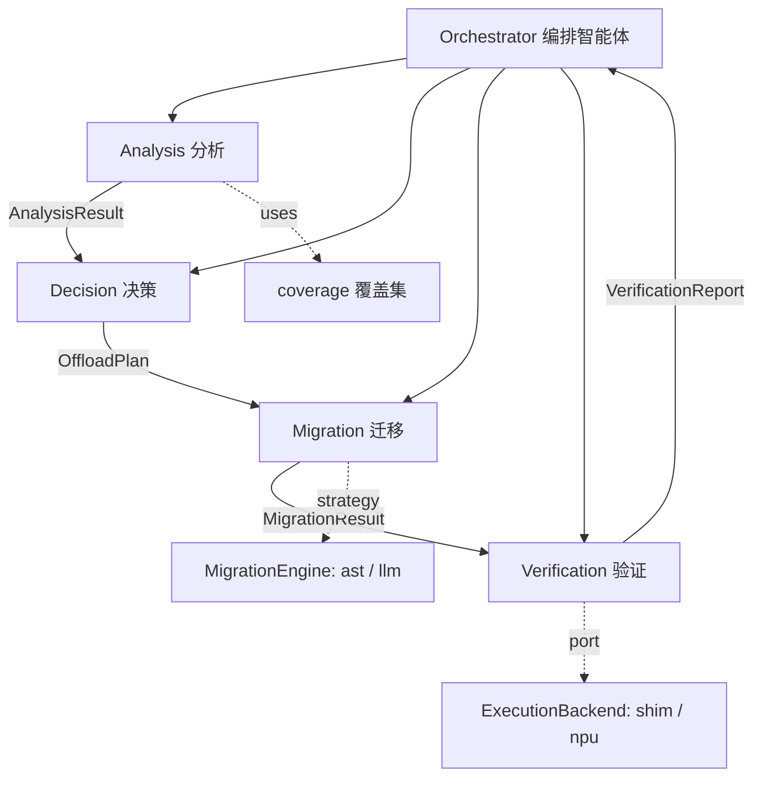
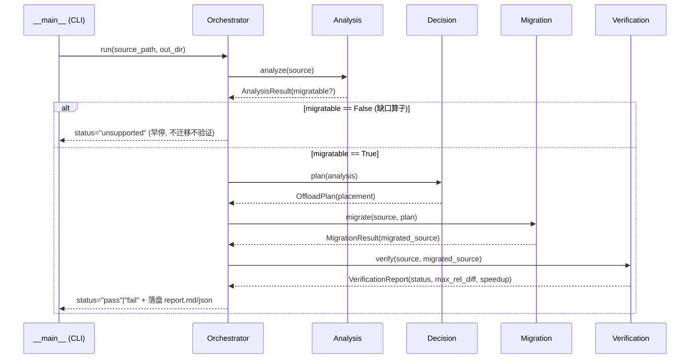
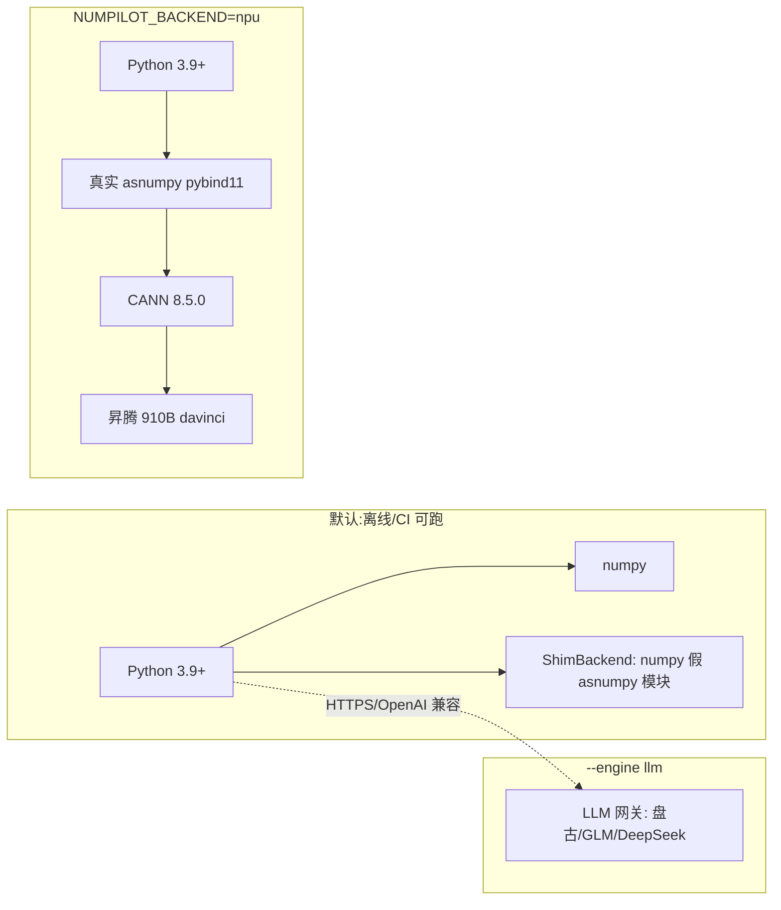
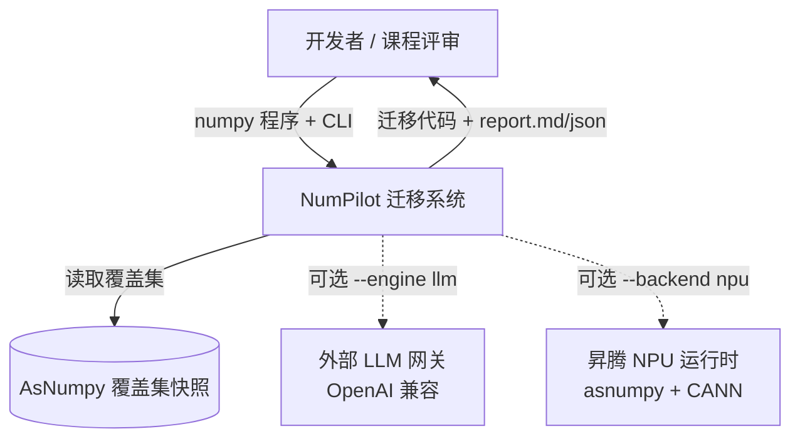
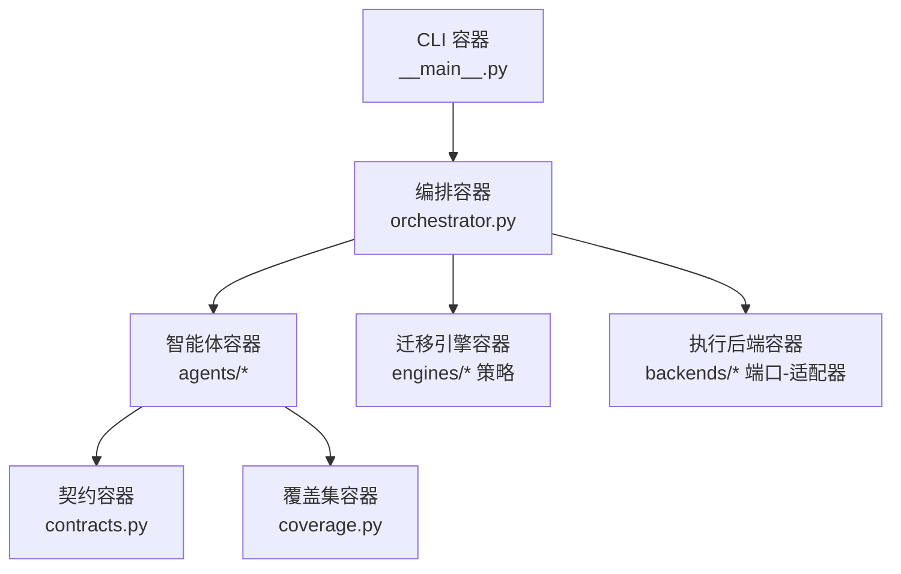
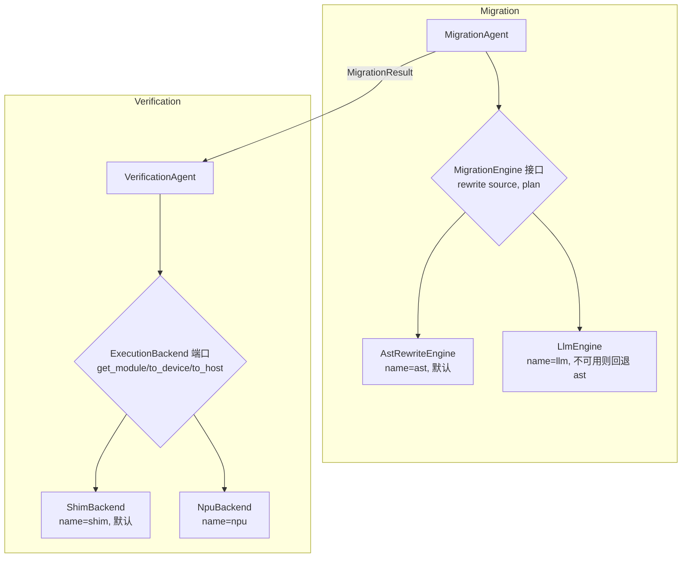

# NumPilot 架构说明(4+1 视图 + C4)

> 课程:高级软件体系结构 · 主题:面向科学智能的昇腾 NPU 代码自动迁移智能体(NumPilot)最简可运行 demo。
> 本文用 **4+1 架构视图** 与 **C4 三层模型** 描述系统。

迁移的本质:`np.<op>` → `ap.<op>`(AsNumpy)的源码改写 + CPU↔NPU 数据搬运。系统以**多智能体流水线**组织:分析 → 决策 → 迁移 → 验证,由编排器统筹;组件边界即 dataclass 契约边界。

---

## 一、4+1 架构视图

### 1. 逻辑视图(Logical View)—— 组件与契约

关注职责划分与静态关系。五个智能体各司其职,只通过 `contracts.py` 的 dataclass 交互。



| 组件 | 职责 | 输入 → 输出 | 依赖 |
|------|------|-----------|------|
| Orchestrator | 编排流水线、状态传递、汇总 `report.md`/`report.json` | 文件路径 → 结果 dict | 4 个 Agent、`select_backend` |
| Analysis Agent | `ast` 解析提取 `np.*` 算子清单,比对覆盖集 | source → `AnalysisResult` | `coverage` |
| Decision Agent | 规则成本模型:按张量规模阈值定 CPU/NPU | `AnalysisResult` → `OffloadPlan` | 阈值配置 |
| Migration Agent | 按策略引擎改写 `np.*→ap.*` | source + `OffloadPlan` → `MigrationResult` | `MigrationEngine` |
| Verification Agent | 双端执行 + 数值对比 + 测速 | source + migrated → `VerificationReport` | `ExecutionBackend` |

**契约(`contracts.py`)**:`OpUse`、`AnalysisResult`、`OffloadPlan`、`MigrationResult`、`VerificationReport`。每个 Agent 只认这些类型,内部实现可独立替换与单测。

### 2. 进程视图(Process View)—— 流水线时序

关注运行期交互与控制流。缺口算子在分析阶段即触发早停。



### 3. 开发视图(Development View)—— 包结构

关注代码组织与编译期依赖(单向,无环)。

```
numpilot/
├── contracts.py         # 契约(被所有 agents 依赖, 不依赖任何 agent)
├── coverage.py          # 覆盖集快照(叶子模块)
├── orchestrator.py      # 依赖 4 agents + backends.base + engines.*
├── __main__.py          # 依赖 orchestrator + backends.base
├── agents/{analysis,decision,migration,verification}.py
├── engines/{base,ast_rewrite,llm}.py    # base 定义 MigrationEngine 抽象
└── backends/{base,shim,npu}.py          # base 定义 ExecutionBackend 抽象 + select_backend
```

依赖方向:`__main__ → orchestrator → agents → {contracts, engines, backends} → {coverage}`。`contracts`/`coverage` 为叶子,不反向依赖。

### 4. 物理视图(Physical View)—— 部署

关注运行环境。默认形态零外部依赖(shim);NPU 形态需真实 asnumpy + 昇腾硬件。



- **shim 后端**:`ap.<op>` 转发 numpy,`NPUArray.from_numpy/.to_numpy` 包装;数值恒等,便于复现与 CI。
- **npu 后端**:导入真实 `asnumpy`,在 NPU 上执行;经 `NUMPILOT_BACKEND=shim|npu` 或 `--backend` 切换。
- **LLM 引擎**:仅出站 HTTPS 调用 OpenAI 兼容 endpoint;凭据经环境变量注入。

### +1. 场景视图(Scenarios)—— 用例走查

两条端到端用例(即 `tests/test_e2e.py`):

- **正例(`examples/mlp_forward.py`)**:全覆盖集算子 → `migratable=True` → 决策(未知规模算子→NPU、`zeros` 已知小规模→CPU)→ AST 改写产出含 `ap.matmul(` → shim 双端数值一致 → `status="pass"`。
- **负例(`examples/unsupported_demo.py`)**:`np.fft.fft` 不在覆盖集 → `unsupported=["fft"]` → `migratable=False` → 早停 → `status="unsupported"`(不迁移不验证)。

---

## 二、C4 模型

### C4-L1:System Context(系统上下文)



### C4-L2:Container(容器 / 可部署单元)

本 demo 是单进程 Python 包,"容器"体现为职责边界清晰的模块簇:



### C4-L3:Component(组件,以 Migration + Verification 为例)



两处扩展点均为**面向接口**:新增引擎只需实现 `MigrationEngine.rewrite`,新增后端只需实现 `ExecutionBackend.get_module/to_device/to_host` 并在 `select_backend` 注册——不触碰编排器与其它智能体。

---

## 三、关键架构决策(详见 `docs/adr/`)

| ADR | 决策 | 一句话理由 |
|-----|------|-----------|
| [001](adr/ADR-001-strategy-migration-engine.md) | 策略模式迁移引擎 | AST ↔ LLM 可替换,回退保证可跑 |
| [002](adr/ADR-002-ports-adapters-backend.md) | 端口-适配器执行后端 | shim ↔ NPU 可移植,离线可测 |
| [003](adr/ADR-003-contract-first-agents.md) | 契约先行的智能体 | 组件边界即契约边界,可独立单测 |
| [004](adr/ADR-004-scope-no-gap-op-gen.md) | 裁掉缺口算子生成 | 聚焦最简可运行主干,缺口仅标记终止 |
